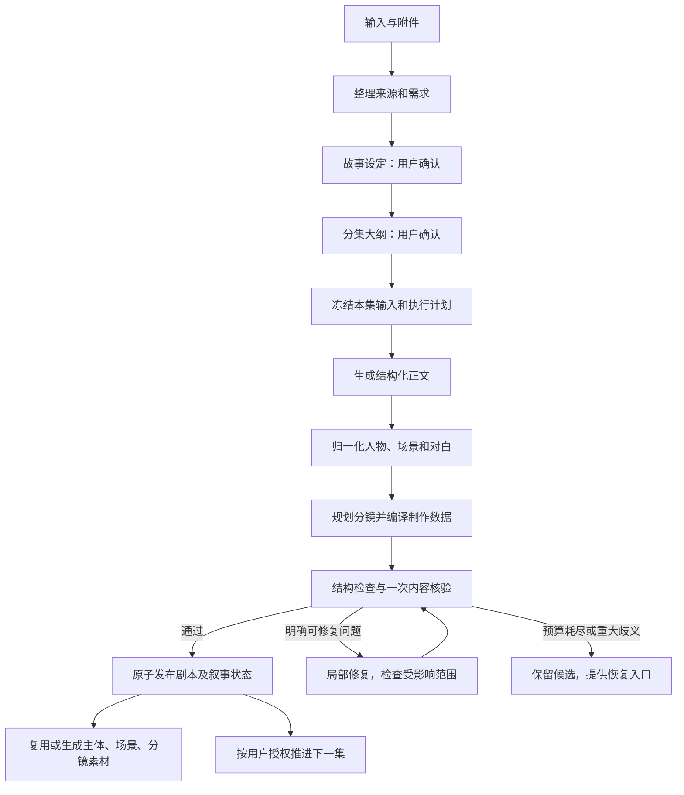

# 短剧生成可靠性重构 PRD

- 日期：2026-10-09
- 文档版本：1.0
- 状态：设计交付，尚未实施、尚未达到上线验收标准
- 适用范围：短剧创作、短剧画布的故事设定、分集大纲、逐集剧本及制作交接
- 交付分支：`feature/short-drama-generation-prd`，仅文档
- 评估代码基线：本地 server develop `ba4b92be8`；web develop `4e2aea82`

## 1. 产品决策

保留用户能够理解的大流程：**故事设定 → 分集大纲 → 逐集生成 → 主体、场景、分镜制作**。重构内部生成、数据表达、核验和恢复机制。

本方案重新确定产品规则，不把过去的质检开关、14 秒拆镜、时长误差百分比、固定镜头数量、逐事件单元生成、原文全部锁定、多层审核视为必须继承的要求。旧任务的历史数据仍按历史版本解释。

核心决策：

1. **一份剧本内容作为唯一事实来源。** 角色、动作、对白先形成结构化正文；阅读版剧本、分镜和提示词均从它派生，避免正文和分镜各写一遍。
2. **模型负责创作，系统负责数据正确性。** 数据库 ID、引用、排序、版本、汇总、状态和计费由系统维护。模型使用短别名表达人物与场景。
3. **短集优先整集生成。** 只有输入或预计输出超过模型容量时才分场处理。不能因内部骨架分成四段，就让四段各自扩写成一集。
4. **核验成为默认流程。** 删除新流程中的“质检核验”开关。基础检查始终执行；内容、人物、连续性合并为一次有明确范围的语义核验。审美润色另设完成后的操作。
5. **修复必须有限且局部。** 格式、同义别名、重复登记、计数和引用的小错误优先由代码消化；模型只修复明确的内容缺口。失败保留候选内容和已付费返回。
6. **可读、可制作、媒体完成分别表示。** 有草稿不等于生成成功，有剧本不等于已经生成视频；用户始终能查看已保存内容和下一步动作。
7. **两入口使用同一个核心。** 普通短剧和画布只负责不同的展示、页面组织及推进交互，不各自实现一套剧本生成规则。

这需要分阶段替换生成核心，不能通过继续给现有校验器添加例外完成。已有可靠的收据、权限、市场调用、资产存储能力可以保留，但必须通过对应回归用例后接入。

## 2. 成功的定义与边界

### 2.1 用户拿到的结果

一集标记“剧本就绪”时，必须同时具备：

- 可阅读的完整本集正文，包含约定的开场、主要事件、人物行动和本集结束状态；悬念结尾允许，但不能以半句、半场或输出截断冒充悬念。
- 每段对白都有明确的发言者或旁白类型；多人对白的内容和顺序完整。
- 主要人物身份、人物关系和关键事实与已确认设定、前集已发生事件一致；身份变化、闪回、误认有正文依据。
- 有可执行的分镜表达，人物和场景引用有效，正文中的必需动作与对白有制作去向。
- 有可继续生成主体图、场景图、分镜图及视频的制作清单；尚缺素材明确列为待生成，不属于剧本失败。
- 已保存规范版本、来源、验收结果和依赖版本，可在切页、刷新和进程重启后恢复。

### 2.2 可靠性目标

目标是让正常需求在有限成本和时间内自动完成，并让模型小错误不再成为用户可见的失败。不能承诺上游永不宕机、矛盾需求永远可满足或自动审核绝不漏判。

遇到无法自动解决的问题，应留下完整候选、具体原因和可执行恢复入口；禁止用关闭检查、删除剧情、清空错误、把未完成标记为成功提高统计数字。上线指标和测试口径见第 19 节。

### 2.3 本次范围

覆盖输入整理、故事设定、大纲、单集正文、分镜规划、人物场景身份、连续性、任务恢复、前端状态、制作交接、版本迁移和验收。

视频模型本身的画面质量、口型精度、外部服务可用性不由本次重构保证；本次负责提交正确内容、能力匹配、失败隔离与恢复。AIGC 其他应用、主题样式、公共市场协议和发布系统不属于改造范围。

## 3. 现状证据与系统性风险

以下区分已观察事实和需要防范的设计风险。历史任务用于确认问题类型，不用于推导全站失败率。

| 依据 | 观察 | 设计结论 |
| --- | --- | --- |
| 先前排查的项目 3809 第 2 集；旧定时生成逻辑 | 初步规划把廊下事件绑定大厅，正文合理使用已登记花廊仍被拒绝 | 系统初稿地点不能成为不可更改的用户约束 |
| 项目 3812 第 1 集，任务 `sd_plan_202610090311532861` 的先前实测 | 审计阶段字段超长曾在调用前失败；后续又因重复主体登记失败 | 基础设施错误和可归一化的模型格式错误都能阻断内容；必须分层处理 |
| 同次任务返回；当前逐单元展开逻辑 | 第一单元已输出 12 镜约 39 秒，整集还有后续单元 | 每段独立扩写容易造成时长和镜头膨胀；不能只靠提示“控制数量” |
| `ShortDramaContentFirstGeneration::registry` | 已存在 ID 再次出现会直接报“编号无效、重复或覆盖已有实体” | 相同人物重复声明应幂等合并，真正身份冲突才需要处理 |
| 当前 ContentFirst、UnifiedReview、TimingRepair、旧审核链并存 | 生成、时长、审核分别有修复和预算逻辑 | 需要一个执行计划与总预算，避免嵌套重试和修复相互破坏 |
| `ShortDramaPlanningUnit` | 已有返回持久化、签名和恢复基础 | 可以复用，但仍需验证并发、未知提交结果和版本隔离 |
| `canvas_agent/ConversationProduction` | 画布已有委托普通短剧服务的路径 | 可以收敛为共同领域核心，不必重做整个画布 |
| `ConversationAssetReuse` | 复用签名依赖精确提示词及模型等信息 | 相同人物仅改措辞可能失去复用，需要把身份与生成参数分开 |
| 页面切换后恢复及五十多个镜头的用户反馈 | 存在重复展示、重放或内容膨胀的可能 | 必须分别排查“重复渲染、重复写入、模型过量生成”，不能只凭界面计数归因 |

全局还必须覆盖：长文件跨集污染、输出截断、错误审核、未知上游结果、双击提交、多 worker 竞争、过期回调覆盖、取消后结果返回、历史修改影响后集、模型下架、计费不一致以及租户越权。第 16、18 节规定对应处理。

## 4. 用户流程

### 4.1 输入与故事设定

用户输入灵感、粘贴文本或添加文件；点击发送后创建一次后台作业。文件选择完成只表示附件已上传，不表示剧本已经解析。

后台完成文件提取、来源分段、需求归纳，再生成故事设定。页面展示解析进度和提取结果，不把整份文件原文覆盖进用户仍在编辑的输入框。输入框保留用户指令；解析正文以可展开资料卡展示，后续自动用于本次创作。

故事设定包含：故事目标、主要人物及关系、世界背景、总体剧情方向、画风、输入处理方式、拟生成集数和时长目标。用户可修改后确认。只在会改变故事的重大歧义处请求选择，例如“前 5 集”还是“100 集压缩成 5 集”；一般细节由系统补足。

### 4.2 分集大纲

确认故事设定后生成大纲。每集包含核心事件、开场状态、结束状态、主要人物、预计时长和与前后集的关系，不在此时规定镜头编号、镜头数量和逐镜地点。

用户确认的是故事走向及分集边界。模型生成的大纲修饰语不会自动变成逐字强制要求。明确标注为核心的事件和状态变化才进入本集内容验收。

用户确认大纲后开始第 1 集。首页输入与画布输入提交同一种请求，差别只是结果展示位置。

### 4.3 逐集生成

普通短剧入口：大纲确认时提供明确的“生成本集”与“连续生成剧本”操作。连续生成按集串行推进，上一集剧本就绪且叙事状态提交后才生成下一集；不等待图片或视频完成。

画布入口：默认生成当前集剧本，在同一个画布项目中放入对应页面。当前集进入制作后，持续显示“继续下一集”入口；完成当前集制作时主动提示。用户可提前继续剧本，不被失败的视频任务锁住。下一集的后台前置条件是上一集剧本就绪，不是媒体成功。

两入口的不同是用户授权的推进方式。连续生成授权只包含剧本；图片、视频等付费制作仍按用户明确的制作操作执行。

### 4.4 进入制作

剧本就绪后展示正文、人物场景清单和分镜。已有合适资产直接填充，缺失资产待生成。分镜中的对白、画面和制作提示词保持同源。

每集可在原画布左下角页面列表中切换，页面名默认“第 N 集 · 标题”。页面 ID 是展示位置，不能作为剧本任务或人物身份 ID。普通短剧仍可按集进入制作页。

### 4.5 修改与异常

生成期间，用户可查看已保存候选、取消或离开页面。刷新只读取后台状态，不重复提交。修改已确认设定或已完成剧本时创建新修订，旧的已就绪版本继续可见。

错误卡片显示具体阶段、已保留内容、下一步和费用状态。例如：“正文已保存，分镜整理暂未完成；继续时从分镜整理开始。”前端不展示原始数据库错误，也不把内部校验错误统一称为模型调用异常。

## 5. 输入处理与需求边界

### 5.1 输入类型

| 类型 | 默认处理 | 必须保留 | 可以补充 |
| --- | --- | --- | --- |
| 灵感、梗概 | 创作 | 用户明确要求、确认后的核心设定 | 情节细节、对白、过场 |
| 小说、未分集长文 | 改编 | 核心人物关系和选定范围内主要事件 | 分集方式、对白、可拍摄动作 |
| 已分集完整剧本 | 忠实制作 | 原集边界、事件、说话人及对白 | 镜头语言、必要转场和制作说明 |
| 已有分镜脚本 | 结构导入 | 内容、顺序、已有明确时间码 | 缺失的制作字段 |
| 用户修改 | 定向修订 | 未受影响内容及用户锁定项 | 指定范围内内容 |

“忠实制作”保留原对白；“改编”允许改写对白以适应表达，但不擅自改变核心事件。用户在故事设定确认卡中能看到并切换处理方式。原文件和提取原文始终保留，不被归一化结果覆盖。

### 5.2 需求优先级

1. 用户当前明确指令和人工修改。
2. 已确认的核心人物身份、世界规则、分集事件及原文保留范围。
3. 已发布前集的实际发生事实。
4. 时长、节奏、风格等创作目标。
5. 系统生成的镜头、场次和措辞建议。

前三项相互冲突时，不按优先级静默改写历史，而是生成具体冲突说明和修订方案。后两项可为内容完整性调整，并记录调整。不得把“约一分钟”解释成严格 60 秒验收，也不得把系统推荐时长升级成用户硬约束。

每条需要验收的要求记录 `requirement_id、来源引用、内容、类型、适用集、保留策略`。只有用户原话或确认的核心事件能建立阻断性要求；系统不能无限提取细枝末节变成硬条件。

确认之前检查核心要求之间是否相容。例如原文要求主角在本集仍不知道秘密，而大纲安排其主动揭露秘密，应修正大纲或让用户确认故事改动，不能把矛盾同时提交给正文模型，再要求模型反复自我修复。

### 5.3 长文件

文件提取先使用确定性解析器，保留页码/段落/集边界和文本哈希；扫描件等无可用文本的输入明确进入 OCR 或提示处理，不能提交空文本给模型后虚构解析成功。

目录、页眉、重复页脚不进入正文；删除这些内容需记录来源映射。分集识别有歧义时展示识别范围。选取前 5 集仅处理这 5 集，后续原文作为可检索资料，不整体灌入每一集。

资料中的指令性文字作为故事内容处理，不能改变任务系统指令、权限或计费操作。上下文装不下时分块整理并保留原文引用，禁止直接截掉文件尾部。

## 6. 统一生成核心



图中的修复循环受第 10 节总预算和第 11 节收敛规则限制，不能无限循环。

### 6.1 阶段输入输出

| 阶段 | 输入 | 输出 | 完成条件 |
| --- | --- | --- | --- |
| 来源整理 | 原文、附件、用户指令 | SourcePackage、Intent | 来源完整、范围可识别 |
| 故事设定 | Intent、资料索引 | StoryBible 修订 | 设定可读且核心冲突已处理；等待用户确认 |
| 大纲 | 已确认 StoryBible | SeriesOutline 修订 | 集数、边界、核心事件、前后状态闭合；等待确认 |
| 本集准备 | 已确认大纲、本集来源、前集事实 | EpisodeContract、ExecutionPlan | 冻结依赖、检查容量和预算 |
| 正文生成 | EpisodeContract、相关记忆 | ScreenplayCandidate | 完整场景及正文单元落盘 |
| 规范化 | 正文候选、实体注册表 | CanonicalScreenplay | 身份引用唯一、对白结构有效 |
| 分镜规划 | 规范正文、制作配置 | ShotPlan、ProductionPackage | 正文内容有制作去向，引用和顺序有效 |
| 验收 | 上述全部及核心要求 | AcceptanceReport | 无未解决阻断项 |
| 发布 | 验收通过的同一修订 | ReadyRevision、叙事状态增量 | 同一事务提交，下一集可读取 |

### 6.2 短集与长集

本集准备按配置中模型真实上下文和输出上限，估算输入及输出容量，并预留安全余量。模型能力缺失时不能假定无限上下文；使用该渠道经过测试的保守上限。

正文和预计输出均可容纳时，一次生成完整正文；一次规划分镜；一次合并语义验收。这是普通短集的默认三次模型调用，文件解析、故事设定和大纲不计入此单集数字。

只有预计容量不足或真实返回明确截断时，按连续场景分段。每段携带整集事件分配、已完成内容摘要、当前段入口/出口和剩余内容范围；不把每段当成独立完整剧本。

已完整返回的场景单独保存；截断的场景重新生成或续写，拼接必须通过事件覆盖和边界重复检查。无完整 JSON 或完整正文单元时，保存原始收据但不发布为可制作内容。

长集的分段数量由容量计算决定，不固定“一集四段”、每段若干镜头。分段执行计划需落盘，恢复时沿用原计划；调整计划建立新版本并明确哪些旧结果仍可复用。

基础调用数按实际输入类别减少：已经完整结构化并验证的上传剧本可直接规范化，跳过正文创作；已有可用分镜可跳过重新规划。默认三次是原创短集的标准路径，不能为了凑齐阶段而重写用户已提供的完整内容。

### 6.3 多集大纲也要控制容量

大纲能一次容纳时一次生成。长系列先规划故事阶段及事件归属，再按连续集段展开；每个核心事件有归属集，跨段边界做一致性检查。全系列确认前不得把部分大纲误标完整。

大量分集可以分批确认，但确认的是明确集段及所依赖的故事阶段。未确认的远期细节不能阻塞已经确认的前期集段，也不能被当成已发生事实。

## 7. 内容数据契约

以下是目标领域契约，具体数据库物理字段由第 17 节实施批次建立；不得直接把这些对象全部要求模型填写。

### 7.1 模型输出与系统字段

正文模型只负责：标题、按顺序的场景、动作、对白、必要的新人物/地点说明及结束状态建议。人物和场景使用已提供的短别名，例如 `c1、c2、l1`。

系统负责：租户/用户/项目/集 ID、修订 ID、场景和正文单元 ID、实体 ID、分镜 ID、顺序、签名、来源映射、状态和合计。

规范正文的最小形状：

```json
{
  "revision_id": "系统生成",
  "episode_id": "系统生成",
  "dependency_versions": {"bible": "b3", "outline": "o2", "previous_episode": "e1r4"},
  "scenes": [{
    "scene_id": "系统生成",
    "location_id": "系统解析",
    "time_context": "傍晚",
    "units": [
      {"unit_id": "a1", "type": "action", "text": "陈默合上卷宗，走向门口。", "entity_ids": ["c101"]},
      {"unit_id": "d1", "type": "dialogue", "speaker_id": "c101", "speech_type": "spoken", "text": "我去把事情问清楚。"}
    ]
  }],
  "source_links": [],
  "ending_state": [],
  "status": "draft"
}
```

`unit_id` 在规范化时分配；示例的 `a1、d1` 为方便阅读。模型短别名与内部 ID 的映射保存在该次请求上下文中。

### 7.2 单一内容来源

- 阅读版剧本由规范正文渲染，不维护另一份模型生成的 `script_lines` 真相。
- 分镜引用 `unit_id` 及对白片段范围，显示时解析真实文本。提示词可以包含派生副本，但必须带正文版本哈希。
- 每段对白在声音时间线上覆盖一次；可跨多个画面延续，但不能重复发声或漏掉尾句。
- 同一动作可由多个镜头表现，覆盖检查允许一对多；不能仅因为动作 ID 重复就认定剧情重复。
- 修改对白只修改正文修订，再更新受影响分镜、声音段和提示词。编辑分镜里的对白也必须走这一操作。
- 分镜拆分、排序变化不改变角色身份和已有正文单元身份。删除内容必须显式修改正文，不能在编译分镜时静默丢弃。

### 7.3 人物与场景身份

注册表包含 `entity_id、kind、canonical_name、aliases、identity_facts、appearance_versions、source_refs`。地点支持父子关系，例如“程府—大厅”“程府—花廊”；二者是不同可拍摄空间，不被强行合并。

身份解析顺序：已提供短别名 → 本项目唯一且已确认的别名 → 一致的重复声明合并 → 有证据的新实体登记 → 对歧义做一次定点解析。

同一人物重复出现在返回中不报错；新描述相容时补充候选说明，不自动覆盖已确认身份。相同名字但关系或年龄冲突时不能自动合并。错别字只有在唯一匹配且上下文一致时修正，并记录变换；不能用模糊匹配把两个人合并。

旁白和匿名群演允许用明确类型表达；具名发言角色必须可定位。路人无需全部生成主体图，但若持续出场或承担关键对白，应建立角色身份。

年龄、服装、伤势、变身、昼夜等使用外观或状态版本。人物身份不因换衣服变成新人，资产也不能因同名就跨版本误用。

## 8. 分镜与时长设计

### 8.1 正文先控制内容密度

生成正文时提供目标时长、核心事件和表达方式，要求模型据此安排对白与动作。系统估算对白和动作所需时间，作为创作反馈。

未指定时长时按内容自然结束。普通时长选择器表达“目标时长”，不设置统一的 ±10% 成功门槛。明显超出目标时，创作模式可在修复预算内进行一次内容密度调整；忠实制作优先保留原文并展示估计时长。

严格时长作为高级约束，用户明确选择后才启用。仅靠字数不能保证精确秒数；剧本阶段展示可行性估计，成片阶段用实际音频和剪辑校准。若保留对白与严格时长不可兼得，应在付费制作前给出“延长时长 / 允许压缩对白”的选择，不能伪造秒数。

### 8.2 分镜规划

模型读取规范正文，规划景别、构图、动作、运镜和正文引用；无需重写对白和人物列表。系统解析引用，计算对白覆盖、顺序、时长估计和制作提示词。

镜头数按叙事需要确定。只有检测到重复内容、无意义碎片化或容量异常才触发整理，不设置所有剧本通用的固定镜头上限。产品显示真实镜头数，不使用摘要中的旧计数。

分镜至少包括：稳定 ID、正文修订、引用的动作/对白范围、场景及人物引用、视觉说明、估计时长、顺序和制作状态。

### 8.3 叙事镜头与生成片段

叙事镜头是编辑层概念；视频模型生成片段是执行层概念。一个长镜头可以由多个生成片段实现，多个短画面也可以在模型支持时合并生成后剪辑。页面分别显示镜头和片段，避免将片段数量误认为新增剧情。

不保留全局固定“对白超过 14 秒就新增分镜”的规则。依据所选视频模型支持的时长、声音能力和实际对白估计规划片段。优先在发言轮次、句子或自然动作处拆分；拆分保持说话人、文本顺序和情绪连续。

语速估算提供区间，并区分语言、旁白、停顿和多人轮次。初版参数使用测试语料校准，参数带版本；不得把固定字数除数当作实际配音时长。已经生成或上传音频时以音频长度为准。

模型不支持原生对白时，制作包明确选择配音/后期合成路径；无法满足所选制作方式则显示能力不匹配。更换视频模型仅重编译片段计划，不重写已通过剧本。

### 8.4 制作提示词

图片提示词取视觉内容、人物外观、场景及画风。视频提示词额外取动作、运镜、时间关系和声音段；多人对白按顺序明确发言者。非发言人物不附加其对白。

提示词由版本化模板编译，确需模型润色时只允许修改视觉表达，不能改正文事实和对白。编译结果关联正文与分镜哈希，过期提示词不得发起新制作任务。

## 9. 验收设计

### 9.1 两层检查

第一层由代码执行：格式、必要字段、引用、身份映射、对白覆盖与顺序、来源范围、输出完整性、版本依赖、数值及制作参数。这类可确定问题不反复交给模型判断。

第二层进行一次合并语义验收，检查：核心事件是否在正文中实际发生；人物身份和发言是否正确；前后因果及已确认事实是否冲突；分镜是否严重歪曲或遗漏正文。风格、措辞和“还可以更精彩”作为建议。

普通短集在一个请求中核验全文与分镜引用。长集按内容容量分窗口核验，并增加一次整集核心事件与边界检查；每窗口携带全局要求的适用范围，不要求某窗口包含整集所有事件。

### 9.2 问题等级

| 等级 | 示例 | 是否阻断 |
| --- | --- | --- |
| 数据错误 | 引用不存在、对白未覆盖、截断、缺失说话人 | 阻断，先自动归一化或局部修复 |
| 明确内容错误 | 主角身份错、核心事件缺失、无依据提前知道秘密 | 阻断，定点修复 |
| 重大歧义 | 同名角色无法区分、用户要求冲突 | 无法自动判定时等待用户选择 |
| 表达建议 | 节奏可更快、措辞重复、非关键动作可增强 | 不阻断，以建议保存 |

### 9.3 核验本身也需要约束

报告必须包含 `issue_id、code、severity、requirement_or_fact_id、正文/镜头定位、证据、建议修复范围`。证据必须引用实际文本，不能只说“感觉不连贯”。缺失事件的证据需要明确检查范围和应该出现的内容，不能以某个窗口未出现推断全剧缺失。

代码检查引用及引文真实性。明显无效的审核问题不触发内容重写；在预算内重做该问题的判定。对有冲突的重大判断最多执行一次定点裁决，裁决仍不确定则保留候选，转为待确认。模型输出空报告、非法状态或调用失败不能视为审核通过。

验收报告记录原始问题和处理结果。审查通过代表满足本系统的发布条件，不代表保证零艺术缺陷；发布前样本还必须经人工抽检。

### 9.4 质检开关处理

新流程移除“质检核验”开关，核心验收默认执行。新接口收到旧客户端的开关字段时，不允许其关闭新流程的必需检查；返回所用策略版本。历史任务重放仍解释原策略，不悄悄变更已付费任务的语义。

“润色剧本”作为剧本就绪后的可选新修订操作，可改善节奏和表达，不与生成成功绑定，也不默认触发额外付费调用。

## 10. 执行预算与调用计划

每个作业只有一份持久化预算账本，记录模型请求数、输入/输出 token、上游成本、用户点数预留、累计耗时和自动修复次数。所有阶段共享账本，不允许子服务另开无限预算。

初版默认值是待基准测试校准的运行参数，不能在运行中偷偷放宽：

| 项目 | 默认值 |
| --- | --- |
| 普通短集基础计划 | 正文 1 次 + 分镜 1 次 + 合并验收 1 次，共 3 次 |
| 普通短集额外请求额度 | 最多 5 次，格式修复、裁决、内容修复及复核共同消耗 |
| 内容修复 | 每集最多 2 轮；每轮修复与复核分别计请求 |
| 模型格式修复 | 每个失败单元最多 1 次，仍受总额度限制 |
| 长集基础计划 | 正文 N 次 + 分镜 N 次 + 窗口核验 M 次 + 整集核验 1 次 |
| 长集额外请求额度 | `min(12, max(5, ceil(基础请求数 / 2)))`；内容修复仍最多 2 轮 |
| 未提交成功的瞬时连接故障 | 最多 2 次延迟重试，使用退避和抖动 |
| 明确限流 | 遵循渠道等待信息和任务截止时间；不占内容修复轮次 |

所有已发出的请求，包括格式失败、被拒绝候选和废弃分段，都计入实际调用及成本。回放已保存收据不算新调用。额度耗尽保留候选并停止，用户点击恢复不会清零累计消耗；若确需增加预算，展示预计增量并形成显式的新执行授权。

“最多两轮”不是保证一定执行两轮。例如正文修复需要同时重新规划分镜，则该轮至少消耗修复、分镜、复核三次请求；普通短集剩余额度不足时不能再启动下一整轮。开始一轮前预留其完整预计开销，避免修到一半才发现没有复核预算。归一化不消耗模型次数；语义裁决、事实补充、提示词模型润色等额外调用都必须计入同一额度。

每阶段超时和作业截止时间按渠道实测配置，存入计划。PRD 不虚构所有模型通用的响应时限。上线前必须填入经过负载测试的值；缺少配置的渠道不能进入新流程白名单。

故事设定、大纲、文件语义整理也使用相同账本机制，各自建立有限执行计划。长篇分块的基础次数在提交前预估；超过产品成本上限时要求缩小范围或明确追加授权，不能后台无界调用。

## 11. 自动修复与收敛

### 11.1 无模型修复

允许安全处理：去除响应外围代码围栏；接受协议中明确等价的空数组/空值；唯一别名映射；相同实体重复声明合并；系统重算序号和总时长；补全可由上下文唯一确定的引用；重建派生提示词。

每次处理保留原响应、变换类型和结果哈希。不使用 `eval`；不靠全局替换逗号引号“修好”JSON；不把缺失对白补成空字符串通过检查；不从错误输出中猜测故事结局。

### 11.2 局部模型修复

修复请求包含目标问题、原文证据、允许修改的正文/分镜 ID、需要保留的内容、前后上下文和期望差异。返回受限补丁，系统校验修改范围后应用到新候选版本。

正文改变时，重新规划受影响的镜头区间；仅镜头引用或构图错误时，正文保持原版本。修复后的基本检查覆盖全文，语义复核聚焦修改区间及其依赖事实，长集不重跑所有无关窗口。

### 11.3 防止越修越坏

每轮必须消除至少一个原阻断问题，并且不新增更严重问题、不破坏已确认核心事件和对白保留要求。未改善的候选拒绝替换当前最佳候选；相同内容哈希重复出现立即停止该修复路径。

同一问题最多修复两轮；实际可执行轮数还受总请求额度限制。达到限制进入 `needs_attention`，展示具体问题并保留最佳候选。不能自动从头再生成整集来绕过限制。

用户选择整集重写时创建新修订并显示成本影响，已有就绪版本和制作资产保留。不同候选的片段只有在依赖和正文来源一致时才可合并。

## 12. 连续性与系列记忆

StoryBible 保存确认的长期身份与世界规则；已发布剧本形成“实际发生事实”；大纲描述未来计划。三者独立存储，不能把未来大纲提前写入历史记忆。

事实至少包含主体、谓词、对象/状态、发生集及正文位置、有效时间、来源修订、知情角色。区分“角色相信某事”和“故事世界中某事为真”，允许误认、谎言、闪回和有依据的状态变化。

事实候选从正文提取，随合并验收检查，不以模型自己填写的 `ending_state` 直接入库。核心状态变化必须有正文动作或对白证据；证据缺失则不写入已发生事实。非关键、无法确定的推论标为未确认，不能在下一集变成硬约束。这个提取和核对并入标准调用的输出契约，额外调用仍计入统一预算。

每集准备时提供：长期核心设定、本集大纲、上一集结束状态、与本集角色/地点/事件有关的历史事实，以及未解决的相关伏笔。最近内容和检索结果都有来源，不能用无来源摘要覆盖原始事实。

只有剧本通过发布时才提交事实增量。发布剧本、更新当前版本、写入事实和发出下一集可推进事件在同一事务/事务消息机制下完成。前集未发布时后集等待，不能使用临时候选形成永久记忆。

用户修改已完成前集后，标记受影响后集依赖过期，保留旧结果可查看；只重验相关事实，不自动重做所有集或全部视频。若变更影响主线，先展示受影响集范围，再执行授权的更新。

长系列上下文增长必须有界。优先保留核心事实和当前相关事实，不能为塞入全文而截掉人物身份或用户硬要求。500 集模拟用于测试索引、队列和版本依赖；不能作为 500 集实际创作成功的证明。

## 13. 后台状态、幂等与恢复

### 13.1 三组独立状态

| 维度 | 状态 | 含义 |
| --- | --- | --- |
| 执行 | queued / running / retry_wait / reconciling / needs_attention / succeeded / failed / canceled | 当前作业如何运行 |
| 剧本文档 | empty / draft / ready / stale | 内容是否完整验收及依赖是否有效 |
| 制作 | not_started / partial / ready / failed | 主体、场景、镜头媒体的制作进度 |

旧任务枚举由兼容层映射，领域核心不依赖“一个 success 表示全部完成”。`ready` 的判定由服务端统一计算，前端不根据镜头数量或流式结束自行推断。

### 13.2 提交与并发

提交使用客户端生成且可恢复的幂等键，服务端绑定租户、用户、操作范围和请求哈希。同键同内容返回原作业；同键不同内容返回冲突。同一集的剧本生成/修订通道只允许一个活动作业，创建目标修订与占用通道在同一事务内完成；两个标签页不能通过生成两个不同修订绕过互斥。

worker 通过租约和递增围栏令牌领取执行权。调用上游前短事务记录调用意图；外部请求在事务外执行；提交返回时验证令牌与目标修订，过期 worker 只能保存收据，不能覆盖当前内容。

数据库唯一约束是最后防线，不能只依赖前端禁用按钮。队列消息允许重复投递，处理必须幂等。页面关闭不取消后台任务，取消需要独立操作。

租约过期只允许新 worker 接管恢复判断，不意味着上次外部请求未发送。已有 `submitted` 或未知结果记录时，新 worker 必须进入对账路径；不能仅因锁过期重新调用模型。

### 13.3 上游结果不确定

连接建立前明确失败可以有限重试。请求已发送但读取超时、进程退出或连接中断时，进入 `reconciling`：优先通过上游任务 ID 查询，或使用渠道保证的幂等键恢复。

渠道既不能查询又不支持幂等时，不自动重复发出可能收费的请求。保存不确定状态，提供等待平台对账、选择重新调用及费用说明；没有查询能力时不显示无效的“查询上游”按钮。不能宣称端到端“恰好调用一次”；系统保证本地只提交一个有效结果并防止自动重复计费。

### 13.4 收据与恢复点

每次请求冻结实际 messages、模型/渠道、参数、输入依赖、提示词版本、规范化版本、预算和签名。完整返回先持久化再解析。JSON 错误不会丢弃已付费返回。

恢复优先级：已发布结果 → 已验收候选 → 已规范化阶段结果 → 原始收据重放 → 明确未提交单元重新执行。相同签名直接复用；依赖改变创建新修订，不能拿旧返回冒充新结果。

每个完整场景、分镜计划和验收报告都是恢复点。流式 UI 只是展示，后台保存才是进度依据。事件带单调递增序号，客户端按事件 ID 去重；恢复先加载快照，再接收后续事件，避免返回页面后把同一内容重复追加。

取消后迟到返回保存为收据，但不自动发布或启动下一集。用户恢复时按有效依赖复用，费用结算按实际已发生调用处理。

### 13.5 持久化故障

调用前无法可靠保存执行意图时停止外部提交。调用返回后主库暂不可写时，响应先进入受控的持久化收据缓冲并触发恢复告警；上线前必须验证缓冲可用性及清理策略，不能使用进程内变量冒充持久化。

审计展示、埋点和非关键日志写入通过异步事件处理，不能因字段长度把已经正确生成的剧本判失败。关键内容、收据或计费账本写入失败仍需暂停并恢复，不能吞掉错误发布成功。

## 14. 模型、计费和资产

### 14.1 模型策略

项目记录文本、图片、视频模型及制作参数默认值；单集可覆盖。创建请求冻结实际模型，页面显示与计价使用同一份选择结果。默认模型不可用时展示替代选项及价格，不悄悄换为更贵模型。

新文本生成核心通过经过契约测试的渠道适配器调用现有统一市场。能力包括结构化输出、上下文/输出上限、超时语义和幂等/查询能力；不得依赖某一家模型特有的隐式行为。

允许在用户已授权的模型与费用范围内执行明确配置的降级，降级必须入账并显示实际模型；身份和内容约束不能随模型降级被关闭。

### 14.2 计费

沿用平台统一点数和退款服务，新增执行预算账本只负责归集，不另造扣点通道。业务任务、上游调用与扣点流水建立可追溯关系；回放、页面恢复和复制复用资产不重复扣费。

上线前明确一次生成报价是否包含自动修复。建议用户按预先展示的剧本生成报价付费，约定范围内自动修复成本由该报价覆盖；超范围新生成必须重新展示费用。若现有计费合同不能支持，先按实际规则明确展示预估上限，禁止隐藏加价。

用户取消、上游失败、未知结果的退款处理复用现有结算规则，未知结果先对账再结算。不能同时退款并把迟到成功结果重新当成新任务扣费。

### 14.3 资产复用

资产匹配以 `项目主体/场景身份 + 外观/空间状态版本 + 画风版本 + 已批准参考` 为依据。提示词措辞变化和默认模型变化本身不使已有合适资产失效。

使用统一存储的资产引用，验证租户、用户权限和文件可用性。失效链接尝试修复存储引用，无法恢复则标记资产待补充；不回退为剧本失败。

主体变装、年龄变化、场景损坏或昼夜变化产生新外观/状态资产。用户确认替换资产只更新对应引用，不重建人物身份。同名但不同人物不复用。

制作任务绑定具体剧本、分镜和资产版本。输入变化后旧媒体标记“与当前版本不一致”，继续可查看，不自动删除。媒体失败只重试该媒体任务，不回滚剧本就绪和系列记忆。

## 15. 前端与接口契约

继续通过现有 `aigc_short_drama` 应用 API 和授权入口。普通页面和画布调用共同的创建、确认、生成、读取、恢复、取消和修订命令；兼容层适配既有接口，不要求一次性替换所有路由。

读接口至少增加：

```json
{
  "job_id": "...",
  "revision_id": "...",
  "pipeline_version": "vnext",
  "execution_status": "running",
  "document_status": "draft",
  "stage": "shot_plan",
  "saved_progress": {"scenes": 3, "shots": 0},
  "last_event_seq": 42,
  "published_revision_id": null,
  "candidate_revision_id": "...",
  "issues": [],
  "allowed_actions": ["view_draft", "cancel"],
  "cost_status": "reserved"
}
```

`allowed_actions` 由服务端根据权限、状态和预算计算。读接口及轮询不得提交生成。修改命令携带 `expected_revision`，并发编辑不满足时返回版本冲突，不能后写覆盖先写。

用户看到的阶段使用“整理资料、生成故事设定、生成分集大纲、编写本集、整理分镜、检查内容、剧本就绪”。无法计算真实百分比时显示阶段和已保存单元，不使用会倒退或长期卡在 99% 的伪进度。

草稿只读查看与“编辑草稿后重新检查”分开。正文已保存但未验收时明确提示；只有就绪版本可以作为正式批量制作输入。用户可以手动编辑未通过内容，编辑后执行所需检查，不能点击“忽略全部”直接冒充已验收。

画布节点投影按 `(canvas_id, episode_id, revision_id, artifact_id)` 幂等更新；同一恢复事件不新增一套节点。页面创建按集绑定关系去重，切页不创建新的画布项目。

## 16. 故障处理矩阵

| 故障 | 自动处理 | 保存与用户出口 |
| --- | --- | --- |
| 相同人物重复登记 | 归一化合并，保留别名映射 | 无需打断用户，记录变换 |
| 唯一可确定的别名/字段类型偏差 | 安全转换并重检 | 保留原收据 |
| JSON 无法解析 | 一次格式修复；截断则调整当前单元 | 原返回和完整单元保留，不能清空整集 |
| 发言者或人物身份冲突 | 定点身份解析/内容修复 | 无法判定时显示具体人物及冲突 |
| 缺少核心事件或结尾 | 局部补写并更新相关分镜 | 修复耗尽仍展示已有正文和缺口 |
| 镜头异常增多 | 检查事件/对白重复与碎片化，整理受影响部分 | 区分镜头与生成片段，不按数量直接删剧情 |
| 时长目标偏差 | 调整创作密度或片段编排 | 保留内容并显示估计；严格冲突需选择 |
| 审核错误或不确定 | 证据校验，最多一次定点裁决 | 不用不实问题无限重写 |
| 上游明确限流/暂时不可用 | 有界等待和渠道策略 | 保留候选、显示等待时间/恢复入口 |
| 上游提交结果未知 | 查询或幂等恢复 | 不自动重复收费调用，待对账 |
| 模型拒绝或不支持输入 | 分类为渠道/内容能力问题 | 解释具体原因，允许修改或换模型 |
| 文件为空、损坏、加密 | 提取阶段停止 | 原附件保留，提示可修复动作 |
| 上下文超限 | 容量预检和按场分段 | 核心要求不得被截断 |
| 余额不足/预算耗尽 | 停在下一次付费调用前 | 展示已有结果和继续所需费用 |
| worker 重启、重复消息 | 租约、围栏、收据恢复 | 不重复追加、不重复发布 |
| 数据库/存储故障 | 暂停提交或恢复缓冲收据 | 显示系统恢复中，不能归因文本模型 |
| 切页、刷新、双击 | 幂等提交和快照恢复 | 原任务继续，展示去重 |
| 取消后迟到结果 | 保存收据，禁止自动发布 | 恢复时按版本复用 |
| 前集修订导致后集过期 | 计算依赖影响、定向重验 | 已有版本和资产保留 |
| 图片/视频失败 | 重试该制作任务 | 剧本仍就绪，后集剧本可继续 |
| 无权限或租户不匹配 | 服务端拒绝读取/写入 | 不暴露其他用户内容或收据 |

## 17. 实施拆解与代码归属

### 17.1 现有模块处理

服务端路径基于 `app/common/service/app/aigc_short_drama/`。

| 当前模块 | 处理方向 |
| --- | --- |
| `AigcShortDramaService.php` | 收敛为接口兼容及编排入口；新核心不继续增加巨型条件分支 |
| `ShortDramaContentFirstGeneration.php` | 作为历史策略保留；新流程以正文契约和整集优先策略替代 |
| `ShortDramaTimedScriptGeneration.php` | 历史任务按原版本运行；新任务不再使用其预锁定镜头计划 |
| `ShortDramaUnifiedReview.php` 及旧多层审核 | 新流程由统一 AcceptanceService 调用；不得新旧审核串联全部运行 |
| `ShortDramaEpisodeTimingRepair.php`、DialogueSplit | 复用有价值的文本切分算法；取消全局硬 14 秒及固定误差门槛 |
| `ShortDramaPlanningUnit.php` | 提取/适配为统一 StageRunner 的收据能力，补齐围栏和未知提交语义 |
| `ShortDramaExecutionPolicy.php`、RepairBudget | 统一到 ExecutionPlan 和一份预算账本 |
| `ShortDramaSourceBoundary.php` | 保留来源映射能力，补完整性及长文件用例 |
| `ShortDramaNarrativeMemory.php` | 接入规范正文事实和依赖版本，验证原子发布 |
| `ShortDramaEpisodeService.php` | 以剧本就绪推进队列，状态分离和修订依赖处理 |
| `canvas_agent/ConversationProduction.php`、ConversationSeries | 只做共同核心的命令适配和页面推进 |
| `canvas_agent/ConversationAssetReuse.php` | 改为身份/外观/画风版本匹配，提示词作为生成记录 |

建议新增 `generation/` 目录，职责拆为 `SourceIntake、ContractBuilder、ScreenplayGenerator、EntityResolver、ShotPlanner、ProductionCompiler、AcceptanceService、RepairCoordinator、StageRunner、RevisionPublisher`。类名可随语言风格调整，职责边界和契约不能混回入口服务。

前端范围：`web/pc/pages/ai/short-drama/` 的首页、计划、分集、单集和制作页；`pc/apps/aigc_short_drama/canvas/`、`canvas_v2/` 中相关任务与节点投影；共享状态适配和 API 类型。画布基础交互和其他 AIGC 应用不随本次重构调整。

### 17.2 持久化契约

优先扩展能满足约束的现有任务/规划单元/版本表；不足时添加下列逻辑存储，不能为了复用把不同状态继续塞入同一含混字段。

| 逻辑记录 | 必需字段与约束 |
| --- | --- |
| GenerationJob | scope、目标修订、pipeline_version、输入签名、状态、阶段、租约/围栏、截止时间、预算快照；同集剧本生成/修订活动通道唯一 |
| StageExecution | job、阶段、单元、尝试号、冻结请求、签名、提交状态、provider_request_id、收据引用、错误分类；同作业同阶段同单元同尝试唯一 |
| ContentRevision | 集、父修订、规范正文、分镜、来源、依赖、验收、内容哈希、状态；发布后不可原地覆盖 |
| EntityRegistry | 项目、实体身份、别名、外观版本、来源；身份 ID 稳定，别名歧义显式记录 |
| NarrativeFact | 来源修订、正文位置、主体/状态/知情范围、有效时间；撤销和替代可追踪 |
| BudgetLedger | job、调用/预留/结算关联、实际 token/成本、修复额度；事件幂等 |
| OutboxEvent | 事务内业务事件、序号、投递状态；重复投递可消费 |
| CanvasEpisodeBinding | 画布、集、页面及投影修订；同画布同集唯一 |

所有读写包括租户和所有者作用域；不能只拿全局任务 ID 读收据。大型原始响应使用统一受控存储，数据库保留引用和哈希。字段长度由协议定义，错误详情和完整阶段键放结构化扩展字段，不能靠不断加长显示字段解决。

### 17.3 工作包与完成门槛

| 批次 | 交付 | 依赖 | 可验收出口 |
| --- | --- | --- | --- |
| P0 基线与契约 | 冻结旧行为样本、API/表结构清单、模型能力配置、失败分类、测试语料、契约 Schema | 本 PRD | 每类旧问题能重放；新契约无歧义；未解决旧失败单列 |
| P1 执行与持久化 | 作业/阶段/收据/预算、幂等、租约围栏、原子发布基础、迁移 | P0 | 故障注入下不丢收据、不重复发布、可恢复 |
| P2 规范正文 | 输入归一、来源映射、实体注册、结构化正文、阅读渲染、短集整集生成 | P1 | 文本和上传均产出完整规范正文；重复实体不失败 |
| P3 分镜及制作编译 | 正文引用式分镜、对白覆盖、时间估算、片段能力适配、提示词编译 | P2 | 正文与制作数据同源；更换制作模型不改剧情 |
| P4 验收与局部修复 | 合并审核、证据约束、定点补丁、收敛、统一额度 | P2/P3 | 已知缺陷检出且小错误自动消化；无修复振荡 |
| P5 系列与资产 | 前集记忆、队列、修订影响、实体资产复用 | P4 | 五集串行、前集修改、相同主体场景复用可验证 |
| P6 两入口接入 | 状态 UI、恢复、确认流程、画布页面与节点幂等投影、移除新流程质检开关 | P5 | 同请求两入口生成契约一致；切页不重复提交/展示 |
| P7 灰度与迁移 | 离线回放、真实基准测试、指标面板、白名单、回滚演练 | P6 | 达到第 19 节标准才开放新建任务默认流量 |

批次之间允许做局部测试，不能把 P2 跑通称为完成重构。P1 的持久化能力必须先于大规模付费实测。每个工作包提交对应接口、迁移、行为测试和验收记录；不以修改行数判断完成程度。

### 17.4 首个完整交付切片

先贯通“文字输入、单集、一个通过适配的模型、普通短剧入口”的完整链路，包含 P1–P4 的必要能力和最小状态 UI，用固定响应完成正常路径及中断恢复。该切片仍在白名单内，不能作为全量上线。

随后扩展上传、五集、第二种模型、画布和已有资产复用，再执行完整 P7 基准。这样每一步都能检查真实端到端行为，同时避免把尚未接入的旧入口继续误认为已经重构。

每批次使用独立可验证的任务提交。涉及 server/web 时采用同名任务分支；遵守仓库的本地 develop 集成和执行规则。数据库迁移先于依赖新字段的 worker 启用，前端只在接口明确返回新流程能力时显示新操作。

## 18. 迁移、兼容和回滚

新流程使用独立 `pipeline_version`，不能只在提示词里加入版本描述。版本还覆盖数据 Schema、规范化器、预算策略和提示词模板；历史执行按冻结请求及兼容适配器恢复。

上一轮 `short-drama-generation-redesign-20261009.md` 保留为历史设计和执行记录。本文件是后续重构的目标规格；旧方案中固定 14 秒、统一时长误差、质检开关、逐单元默认生成及保留多层审核等与本文件冲突的决策不再用于新流程。

迁移采用增量表/字段和兼容读路径。旧项目默认保持原已发布内容，新创建修订可选择新流程；旧任务不会因部署自动全部重跑。未完成任务若无法继续原执行，提供基于已保存资料和收据的新修订迁移，明确可复用范围及可能新增费用。

灰度顺序：离线收据回放 → 测试账号新任务 → 租户白名单 → 小比例新任务 → 默认新任务。自动影子测试不能偷偷重复调用付费模型；优先离线已保存数据，真实双跑只能使用明确授权的测试预算。

回滚关闭新任务路由，保留新版本数据和可读适配器。运行中的新作业在阶段边界暂停或由兼容 worker 完成，不能把其载荷直接交给旧引擎。回滚演练必须验证旧剧本、已生成资产和用户编辑仍可访问。

现有本地未验收重构代码不能仅因已提交就视为可靠基础。P0 逐项标记“保留/改造/历史隔离”，记录旧测试失败；新核心不得依赖未通过的隐式行为。

## 19. 验收与衡量

### 19.1 必须通过的行为用例

| 类别 | 验收内容 |
| --- | --- |
| 输入 | 一句话、长梗概、完整分集剧本、未分集长文、空/损坏附件、选前几集、明确压缩改编 |
| 人物 | 重复声明、别名、称谓、同名不同人、变装、年龄变化、旁白、多人轮流发言 |
| 场景 | 同场转空间、大厅到花廊、同名不同地点、昼夜与损坏状态 |
| 内容 | 核心事件缺失、结尾截断、人物关系错、秘密提前知晓、合理闪回与误认 |
| 分镜 | 正文全覆盖、长对白跨画面、片段拆分不重复说话、无声片段、镜头重排 |
| 时长 | 无目标、约时长、严格时长冲突、实际音频超出估计、制作模型时长变化 |
| 审核 | 不实引文、局部窗口误报、空结果、审核服务失败、修复无改善、修复新增问题 |
| 恢复 | 双击、刷新、切页、断网、worker 杀死、租约过期、重复队列、取消后迟到返回 |
| 收据 | 返回已存但解析未完成、关键持久化失败、上游未知结果、收据回放不扣费 |
| 多集 | 5 集串行、前集失败、前集修订、后集依赖过期、500 集状态/检索模拟 |
| 资产 | 同人物措辞变化复用、换衣不误用、过期文件、跨租户拒绝、媒体失败不清空剧本 |
| 两入口 | 同输入共用核心、同集只建一个页面、恢复不重复节点、旧客户端兼容 |
| 迁移 | 老任务阅读/恢复、混合版本系列、新流程回滚、旧资产和用户编辑保留 |

关键断言必须验证最终数据和外部调用次数，不能仅检查代码包含某句话。模型响应固定样本用于稳定回归，真实模型用于评价生成能力，两者分别报告。

### 19.2 真实基准样本

首轮固定语料包含 20 个单集案例，以及 6 个每组 5 集的连续故事，共 50 集内容。两种通过适配器测试的文本模型各重复 2 次，形成 200 次单集生成观测、24 次完整五集系列运行。

语料覆盖原创与上传、对白密集与动作密集、少量与多人物、转场、明确保留台词和一般改编。保留一部分未用于调提示词的盲测语料，冻结版本后评估；发现失败不能删样本再报告通过。

正常可满足需求进入成功率主样本。矛盾需求、上游故障注入、权限攻击等单独评价“正确识别与恢复”，不能掺入成功率分母后又任意排除。真实正常任务遭遇上游故障必须计入端到端结果，并另报归因。

### 19.3 初版上线门槛

| 指标 | 门槛/要求 |
| --- | --- |
| 自动完成率 | 200 次正常观测中至少 95% 无人工改内容达到剧本就绪，允许预算内自动修复 |
| 系列自动完成 | 24 次五集运行至少 22 次全部完成；同时报告每集位置的失败分布 |
| 严重内容缺陷 | 人工抽检全部基准就绪结果，无缺失核心剧情、错主体、漏对白或无依据历史冲突；发现一例即阻止全量开放并补回归 |
| 确定性数据完整性 | 引用、对白覆盖、版本一致性、租户隔离和重复发布用例全部通过 |
| 故障恢复 | 所有指定故障注入用例保留已有内容；无重复扣点、无过期结果覆盖 |
| 修复成本 | 不超过冻结预算；普通短集无修复路径为 3 次核心模型调用 |
| 可观测性 | 每次失败能定位阶段、类别、收据和版本，前端有对应可执行动作 |
| 性能 | 报告阶段及整集 p50/p95、排队耗时和每集成本；渠道超时配置经压测确认 |

95% 是验收目标，不是本方案已经达到的事实，也不是对所有未来流量的保证。200 次观测和系列内相关性不足以证明长期总体成功率；上线持续报告样本量、模型/输入分组和置信区间，不用单次跑通替代统计。

若门槛未达标，按失败类别修复机制并重跑受影响用例及固定基准。不能临时关闭核验、放松人物正确性或把待确认计为成功。

## 20. 实施记录格式与完成定义

每批次记录：实施提交、影响接口/表、保留旧路径、已通过用例、未通过用例、真实模型任务 ID、费用、剩余风险及回滚结果。文档中的“计划”只有在附有这些证据后才能改成“已完成”。

整体重构完成必须满足：P0–P7 全部交付；两入口接入；新旧版本可恢复；真实基准达标；制作交接和资产复用可用；上线和回滚演练通过。完成一个新生成函数、几个成功任务或减少前端报错均不构成完成。

本次交付仅包含本 PRD。代码仍处于评估基线状态；本文没有宣称旧故障已经修好，也没有启动新的付费生成任务。
