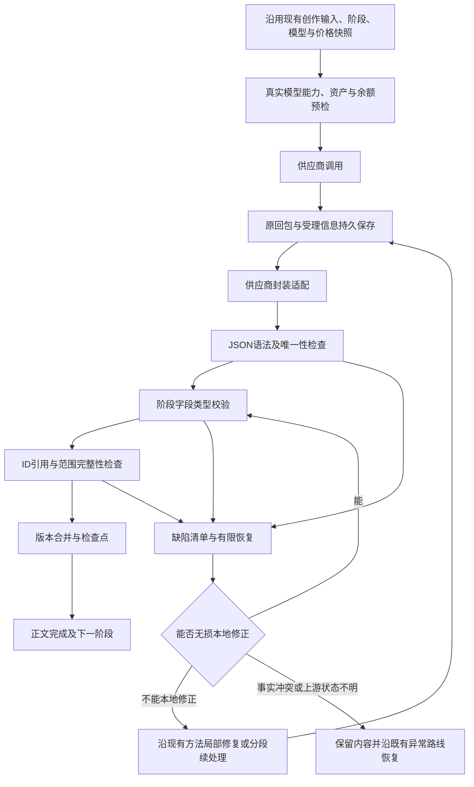

# 短剧剧本生产可靠性专项优化方案

**最新评审约束（2026-10-29，覆盖上一版建议）：取消所有人为累计预算和次数封顶；所有实际模型费用由用户承担；不改变现有创作流程、生成方法、手动/自动模式和确认节点。本次仍只完善文档，未实施。** 先前提出的租户承担内部修复、设置任务预算、达到次数后终止、增加连续生产选项等建议全部撤回。

日期：2026-10-29。状态：**待实施方案**。依用户“先完善优化方案”的要求，本次只做源码只读审计和文档完善，没有修改生成器、解析器、测试、运行配置或数据库，没有发起模型调用。此前已经完成的模型选择恢复和部分数组边界修复，见[总体方案](short-drama-canvas-flow-optimization-2026-10-29.md)，不作为本专项已经实现的内容。

源码基线：server `f401a7c4afeda8440d176186c10a7c48fa504858`，web `b635f877f5a04052b26d072d30a972ee0782f4dd`。新增截图提示“骨架缺少必要内容：subjects”。没有拿到该截图对应的原始回包和任务快照，不能认定某一种原因已被现场证实；以下分清源码已确认的缺口和待实测的风险。

## 1. 目标与不可破坏的约束

交付目标是：有效输入经受控生成后，得到可编辑、可引用、可继续制作的完整剧本；所有标记成功的结果必须满足统一契约。异常可以准确定位、定向修复、断点恢复，已有内容和账目有据可查；不设累计修复次数停止线。

必须同时满足：

1. JSON可解析、类型正确、ID与引用正确、范围完整，才允许进入下一阶段或标记完成。
2. 结构合法不等于剧情完整。另核对用户明确事件、关键台词、人物/场景、集号与收场状态；可选的文学质量复核不影响基础校验。
3. 上游原回包先持久保存。规范化结果、补丁、成功版本单独记录，不能覆盖已付费原文。
4. 已通过的集、场、镜头不随局部修复改写。用户主动调整剧情创建新版本并标记受影响内容。
5. 不用空角色、假地点、虚构台词或拼接括号补成“成功”；不能通过过滤坏项悄悄减少集数或镜头数。
6. 网络受理不明、余额/结算异常、安全拒绝不走普通格式重试；它们有独立恢复路线。
7. 所有真实文本、修复、复核、Agent、图片、视频等调用沿用现有用户收费与租户成本账；查询、解析已有回包、确定性格式适配不产生新的模型费用。用户承担不表示租户成本账被取消，也不新增原本免费的项目收费。

供应商仍可能拒绝、截断或持续返回无效内容。验收要证明系统能正确产出或保留可恢复结果，不能用“任何供应商任何输入100%一次成功”替代工程标准。

### 1.1 本次优化边界

- 原有入口、页面、步骤顺序、生成模板/创作方法、用户输入、模型选择、时长逻辑、手动/自动方式、已有确认、主体绑定、素材复用、导出和收费标准全部作为兼容基线。
- 不新增预算表单、承担方开关、创作模式、强制审核或确认节点；不把当前方法替换为另一套Agent或重写流程。
- 在原有函数边界补齐无损适配、类型检查、字段继承、局部恢复、检查点和费用关联；有效旧样本输出保持一致。
- 不提高文学/创作规则的强制门槛。下文字段契约梳理现有要求与允许形态，不能借统一校验把原来正常的业务变为失败。
- 目标覆盖单集、多集、导入、局部修改、画布、文本、图片、视频等现有业务分支；有效输入与可用上游条件下，不得因内部解析差异、预算封顶、丢字段、引用错误或调度边界导致失败。

### 1.2 移除的封顶与保留的真实边界

| 类型 | 方案要求 |
| --- | --- |
| 项目/任务/阶段/Agent累计金额或点数预算 | 全部取消，不提供“预算用完即失败/暂停”的业务分支 |
| 累计Token、累计预留输出、总调用数、总修复/重试次数、累计创作耗时封顶 | 全部取消，不以内部计数达到固定值终止或要求用户缩小创作范围 |
| 单轮dispatch处理数量、分页、分块、进程时间片 | 仅用于调度，耗尽后持久保存并自动安排下一轮；不计为业务失败，不新增用户确认 |
| 单次模型真实上下文/输出能力、视频规格、供应商并发和限流 | 仍需遵守；沿原有方法做分段、续写或排队，不得粗暴删除请求参数后撞上上游限制 |
| 实际用户余额与租户上游成本余额 | 保留真实余额校验与原有结算；资金不足如实提示，不能伪装为内部预算超标 |
| 权限、归属、安全拒绝、协议/内存安全、结果受理不明 | 保留现有保护与异常恢复；不因取消预算而越权、绕过拒绝或重复收费 |

“时长预算/shot_durations”在原代码中表示镜头时长分配，不能与消费预算混淆。保留既有创作方法和用户明确时长，不用取消消费预算去改写镜头设计。内部固定场次/镜头数若只是单次容器边界，应在原有分段方式下续处理，不能误当整部作品总量上限；真正的产品规格单独核对，不能擅自删除。

### 1.3 已确认的限制位置与处理清单（待实施）

| 位置 | 当前规则 | 本次调整要求 |
| --- | --- | --- |
| ShortDramaScriptGeneration::generate | 非segmented路径46/48次累计调用、183808/192000累计预留输出量；达到后429 | 去除累计停止判断，保留单次真实模型输出参数及既有分段生成方法 |
| AigcShortDramaService::reviewScriptPlanContinuity | 按镜头数计算调用量，最多512；达到后推迟/失败 | 不以复核调用累计量停止；在原复核开关和正文状态语义下续处理 |
| ShortDramaPlanningUnit::call / prepareRetry | attempt达到3后请求耗尽；连接重试亦受累计次数影响 | 清除总次数耗尽分支；连接建立前可延迟恢复，不确定受理仍先核对 |
| ShortDramaPlanningUnit::recoveryKeys | 仅预列3个派生retry身份 | 调整为可持续的稳定派生身份；保留原root、旧key、原请求签名与回执，不循环覆盖旧消费 |
| 普通/定时骨架、字段修复、审校格式恢复的固定循环 | 局部2/3轮后异常向上传播 | 轮内失败保留检查点并继续缺陷恢复，不能把固定轮数作为整个创作的停止线；不重复无变化请求 |
| ShortDramaPlanningUnit::withinDispatch | 每轮有限新调用，余额用完抛425等下一轮 | 作为worker时间片，自动安排下一轮；不是业务预算，不改变已有人工确认 |
| MarketNeuronProvider::chat | 单provider8次限制并影响纠正调用 | 保留现有Agent与工具方法，用持久上下文/检查点续处理，不因总次数到8终止 |
| AgentLongReadService::tick / pause | batch_count达到128转paused/canceled | 保留原分段读取方式，继续排队处理同份资料，不因累计批次数失败或强迫用户重启 |
| AgentExecutionService历史preferences.budget及相关旧偏好分支 | 历史预算可能继续影响工具确认/执行 | 清除预算累计停止条件；仍保留现有手动确认、实际价格变化和受理核对 |
| ShortDramaPlanningState及PC/H5/后台提示映射 | 预算/自动处理上限等可能被归为generation_limit_reached | 不再由人为累计计数产生业务失败；真实模型能力/余额/上游异常分别展示 |
| ShortDramaPlanningBudget / TextModelCapacity::output | 无元数据使用保守上下文；通用输出分支还有32768夹取 | 区分真实能力与应用默认值；核对所选渠道真实声明，不将偏小默认当物理限制；沿原方法分段，不直接删掉单次请求能力参数 |
| MarketImageModelRuntimeService::SUBMIT_MAX_ATTEMPTS / SUBMIT_LANE_WAIT_SECONDS | 图片提交最多3次、通道锁等待片30秒 | 一轮受限可让出执行，不得因累计次数/等待片终止可恢复创作；明确未受理可退避续处理，受理不明先核对原任务，不盲重发 |

这是已确认位置的起始清单，实施前还要跨短剧、画布、Agent和公共运行时检查其他等价停止条件，逐项登记移除或解释其真实物理/业务用途。不能只把常量调大、设为极大值或换一处提示，就声称取消完成。

## 2. 截图错误如何产生，应该如何处理

### 2.1 当前已确认的处理链

`ShortDramaScriptGeneration::assertSkeleton` 与 `ShortDramaTimedScriptGeneration::assertSkeleton` 都要求 `subjects` 非空，缺失或空数组均会抛出截图文案。它不是单纯的页面展示报错，表示结构未通过生产门槛。

`ShortDramaSkeletonFieldRepair::targets` 在 `title/story_outline/subjects/locations` 任一为空时直接返回空目标。现有局部修复主要针对 `scene_beats` 的字段，不能补齐缺失的顶层角色或场景。普通骨架最多尝试2轮，定时骨架最多3轮，顶层缺失会进入整份骨架再生成；再次缺失就终止。

这说明需要保留基础校验，同时扩大“准确补缺”的能力。取消 `subjects` 校验会让后续主体绑定、人物图和镜头引用继续出错。

### 2.2 必须区分的五种情况

| 原始回包/上下文 | 应采取的动作 | 禁止的动作 |
| --- | --- | --- |
| 返回 `characters/roles`，对象结构与已声明适配规则一致 | 在阶段校验前做无损字段映射，记录映射来源，再核验ID与字段 | 任意把同名字符串列表猜成人物对象；有冲突时任取一份 |
| 合法正文仍被 `data/result/plan/payload` 包裹 | 按该供应商明确的封装契约解包，再进入业务校验 | 从任意嵌套/多个候选中挑一个看起来最完整的对象 |
| 回包漏掉 `subjects`，但已确认故事或素材登记中有本阶段权威角色 | 复用权威角色定义及稳定ID；检查本阶段所有引用与已确认事实是否吻合，记录继承来源 | 从角色名字猜ID，覆盖已有角色身份，把全库无关人物塞进当前集 |
| 回包确实漏掉必要角色，且无完整权威来源 | 保存已有场次，仅请求缺失的角色字段补丁；补完后全量交叉校验 | 让模型重写全部剧情，或者生成“默认主角”占位 |
| 用户明确要求纯风景/无出场主体 | 以该任务冻结的条件契约允许空主体；镜头主体引用也必须为空，声音规则另核对 | 对有人物/人物对白的剧本普遍允许空数组，或为了通过校验硬造人物 |

是否属于上述哪一类，需要原回包和冻结输入判断。截图库错误本身不能证明是别名还是漏字段。

## 3. 源码审计：具体缺口与影响

本表是静态代码证据。除总体方案上一轮明确列出的已通过测试，本专项没有运行新的故障复现或模型实测。

| 编号 | 已确认源码行为 | 风险或用户后果 | 改造方向 |
| --- | --- | --- | --- |
| R01 | 共享解析器与 `InputContract::formatRepair` 多处把 `content` 强转字符串 | 数组/对象可能触发PHP异常，修复提示本身也可能再次失败 | 供应商适配层规范化文本，原响应保持类型；解析器做显式类型检查，统一结构错误 |
| R02 | 共享 `decode` 从第一个 `{` 开始，找到闭合对象即返回 | 根列表可能被偷取第一项；多份业务JSON可能只采用第一份，后续内容丢失 | 扫描完整响应、区分object/list、检测二义性和残缺尾部 |
| R03 | 解码为关联数组后，安全wrapper可把列表解出来；重复键被JSON解码覆盖 | 字段被覆盖或错误容器进入业务层，报错位置靠后 | 解析时保留JSON类型信息；重复关键键检测，明确返回契约错误 |
| R04 | 新共享解析仅认特定wrapper；旧主服务还有评分选对象、更多封装与别名逻辑 | 同样的模型回包在不同入口表现不一致 | 统一新任务的适配与校验；旧任务通过版本适配保留已提交语义 |
| R05 | 局部骨架修复要求顶层核心字段已非空 | 缺一个角色/地点列表也只能整份再生成，容易改写已有剧情 | 增加顶层字段补缺，权威素材继承优先，补丁只准改白名单 |
| R06 | 部分骨架/整份剧本校验先用 `empty()`，随后直接 `array_column/array_diff`、数组索引或字符串转换 | 非空字符串、嵌套引用、错误ID类型可绕过浅校验，再出现TypeError/告警 | 所有集合、元素、ID、引用、数字先类型校验，再业务运算 |
| R07 | `canonicalSkeleton` 会转字符串ID；`normalizeSceneScripts` 有字符串转换和过滤 | 结构值可能异常；不合格动作/对白有被过滤、用回退内容替换的风险 | 只做白名单无损适配；明确记录缺陷，不静默丢掉用户/模型返回的剧情 |
| R08 | 非定时完整计划的基础 `assertPlan` 主要检查非空；定时路径又有另一套完整校验 | 不同路径对名称、描述、镜头正文和对白要求不一致 | 一个版本化阶段契约覆盖快速完整输出、分段输出及合并结果 |
| R09 | 一次回包包含部分合格内容时，修复常受原整批/整份边界约束 | 有效场次或集数反复重算，时间、费用和内容漂移增加 | 按字段/镜头/场/集记录验证结果，只补缺失或坏项 |
| R10 | “JSON完成、基础结构有效、正文范围完整、质量复核通过”缺少一致的前台解释 | 出现已显示正文却仍失败、或只看到英文缺字段错误 | 分开草稿预览/正文完成/待复核/待修复/待核对；主提示用可理解中文 |

特别注意：旧 `decodeLlmJsonObject` 的测试明确允许“围栏计划 + 第二份diagnostic JSON”，也允许 `code/data/content` 供应商封装。不能通过全局切换解析器直接破坏这类历史任务，也不能因此允许新入口任取第一份JSON。必须先列出入口、版本、适配profile与测试样本。

主要源码定位（以上述基线为准）：

- `ShortDramaScriptGeneration.php:137–180、280–346`：普通骨架2轮、顶层必填项和分镜校验。
- `ShortDramaTimedScriptGeneration.php:36–113、518–576、574–651、818–839`：定时骨架3轮、素材ID规范化、动作/对白规范化、骨架/分镜校验。
- `ShortDramaSkeletonFieldRepair.php:10–16、45–92`：顶层缺失时退出、限定scene补丁及最多2轮。
- `ShortDramaStructuredResponse.php:13、49、137–185`：content转换、结束原因和对象解析。
- `ShortDramaInputContract.php:99–104`：格式修复原响应处理；`ShortDramaPlanningUnit.php:225–242、274–278`：校验缺陷标记与received重放。
- `AigcShortDramaService.php:17697–17729、20169–20400`：新生成器调用、旧解码/封装与别名恢复；`tests/Feature/ShortDramaTextModelContractTest.php:10–40`：旧入口兼容样本。

## 4. 现有调用内部的兼容处理顺序

以下为原有生成调用中的内部优化位置，不增加或重排用户创作步骤，不替换现有创作方法。

图中的“检查失败”分流只适用于可恢复的结构/业务缺陷。安全拒绝、提交受理不明、价格和结算问题直接进入各自状态，不进入自动格式补丁环。

## 5. 每个阶段的输出契约

契约由服务端根据已冻结的现有阶段选择。模型只返回该阶段内容，不决定tenant/user、价格、任务状态或接下来是否收费。先归纳现有模板、schema与校验要求并消除冲突，不重写创作提示词方法；已被业务支持的合法形态必须保留兼容。

| 阶段 | 必需内容 | 成功门槛 | 不应要求重复返回的内容 |
| --- | --- | --- | --- |
| 故事设定 | title、type_judgement、core_theme、story_outline、subjects、locations；启用对应规则时的series_bible | 文本类型正确；角色/场景对象有稳定唯一ID和必要描述；用户明确事实保留 | 未确认的分集正文、制作分镜、媒体提示词 |
| 全剧节奏 | segments，每段start/end/goal/reveal/ending | 完整连续覆盖总集数，无重叠、越界或提前终结；不改已确认设定 | 每集完整正文、全部素材定义 |
| 分集大纲 | episodes，每项episode_number/title/story_outline/conflict_point/ending_hook | 集号唯一；请求范围完整；批内/全局编号仅做明确一次映射；缺集不能标完成 | 全局角色与场景全表、其他批次正文 |
| 单集分场骨架 | title、story_outline、subjects、locations、scene_beats，以及按版本要求的script_lines/scene_script | 顶层字段类型、角色/场景引用、场次顺序、动作对白结构均有效；定时任务核对原有时长分配 | 完整图片/视频提示词、负面提示词、音乐方案 |
| 局部分镜 | 当前required_shot_ids对应storyboard；镜头ID/场景/主体引用/visual_description/dialogue/voice_role/speech_type/时长 | 数量与ID集合精确匹配，无错场、重复或非法主体；字段类型正确；范围与时长守约 | 已冻结角色/地点全表、其他场次分镜 |
| 字段补丁 | 服务端指定target对应fields或patches | 目标和字段集合与允许范围完全一致；应用补丁后重新检查整体不变量 | 未失败镜头、其他集、其他人物与剧情 |
| 剧本合并 | 引用已通过的设定、大纲、场次、分镜与版本 | 集/场/镜头清单齐全；用户明确内容覆盖；无悬空引用；合格内容版本一致 | 再请求模型重写一份完整剧本 |
| 可选质量复核 | 结构化问题、证据、允许的修复建议 | 对应正文hash和规则版本；正文完成状态独立保存 | 借质量复核改掉用户明确事实，或将格式问题伪装成文学问题 |

统一基础类型：

- 文本字段为字符串，必需正文非空；对象/数组不能通过强转变成文本。允许为空的对白、说话人按speech_type明确约定。
- 集合为list，元素为规定对象；不能用关联map、单对象、逗号分隔字符串代替，除非该profile有经测试的无损适配。
- ID为非空稳定字符串，项目内唯一。历史整数ID仅在明确、无冲突的兼容规则内规范化；禁止数组、对象、布尔ID和通过名称猜引用。
- 引用集合必须逐项为合法ID，先校验类型再求差集。主体、场景定义不能来自其他租户或不属于当前项目的素材。
- 时长是有限正数；用户明确时间码与所选视频能力一致时按其约束，冲突明确暂停，不缩台词/删剧情来凑时长。
- 只校验当前业务已要求的字段，不额外增加必填项。媒体提示词等派生字段继续沿用原有生成与组装方法，不能顺带改变创作结果。

## 6. 返回格式兼容白名单

| 返回形式 | 策略 |
| --- | --- |
| 单个完整JSON object | 接受解析，然后校验本阶段契约 |
| 空白、BOM、单个明确JSON代码围栏 | 去除外围格式标记；不修改JSON内部的台词、标点和正文 |
| 唯一业务JSON前后的普通说明 | 兼容profile明确允许时接受；必须确认无第二业务候选和歧义尾部 |
| 明确单键data/result/plan/payload包裹object | 有界解包；设置深度、字节和递归上限，防止无限嵌套 |
| characters/roles等别名 | 仅当前阶段与profile声明的同构映射可用；两个别名冲突时报错 |
| provider返回原生结构对象或content blocks | 先由该协议适配器按明确约定提取；保留raw，禁止在业务解析器里直接(string)转换 |
| 根列表、wrapper值为列表/字符串、多个业务JSON | 不任取第一项；生成明确契约缺陷，进入有界修复 |
| 重复关键字段或正文JSON后残缺结构 | 不静默覆盖/截取；保留原文，要求明确修复 |
| 非字符串传入只接受文本的共享解析接口 | 类型错误明确返回；修复提示保存原值及类型，不再次强转 |
| 安全拒绝content_filter/refusal/safety | 保留拒绝状态，不做内容恢复或自动绕过 |
| 输出截断length/max_tokens/max_output_tokens | 保存完整字段和完整镜头作为恢复输入；未闭合项不接受为完成；后续缩小单元补齐 |
| 字符串中的括号、引号、围栏和JSON示例 | 按JSON词法识别字符串边界，不能用简单正则从正文中抓对象 |

不在白名单中的新格式先进入诊断样本库，明确其协议含义后再做版本化适配。不能为提高通过率无限扩展猜测规则。支持严格结构化输出的渠道可使用能力开关，仍需后端校验；不支持的渠道不能硬传该参数。

兼容优先：上述拒绝策略仅针对实际不完整、有歧义或不满足现有契约的返回；旧入口已明确支持的诊断封装、单一合法正文等继续按原profile处理。不能用新白名单一刀切拒绝原本正常的响应。结构化输出参数只在现有渠道能力与调用契约允许时调整，不作为换创作方法的理由。

## 7. 最小修复与恢复策略

按以下顺序执行，每一步都重新检查契约：

1. **读原回执**：已有received不再提交相同模型请求；区分未解析、已解析无效、已通过和待核对。
2. **本地无损适配**：外围标记、明确封装、明确别名、稳定ID的安全兼容；记录变换来源和原hash，不收费。
3. **继承权威字段**：从已确认故事、同集素材登记或已冻结阶段恢复缺失角色/场景；核对范围与引用，保留来源版本。
4. **字段补缺**：向模型提交失败字段路径、完整原值、合法引用集合和必要上下文，仅允许这些字段变化。顶层字段与scene/shot字段都有对应补丁契约。
5. **缩小范围**：坏格式或截断发生在多集/多场/多镜头时，保留已通过项目，只生成缺失项；不能因为缩批改变全局编号或场次事实。
6. **持续恢复**：不设累计金额、Token或修复次数停止线。每轮保存进度，使用现有分段方式继续处理；轮内需要让出worker时自动续调度，不让用户因内部次数耗尽重新创建任务。
7. **恢复原位置**：用户继续时先重新验证已保存的原回包与补丁，从缺失单元开始。输入变化时创建新版本，已提交模型、价格和回执不重写。

重复缺陷由进度驱动处理：记录缺陷路径、正文版本、请求与回执指纹，避免无变化地重复相同请求或重复扣费。已有坏回包先重新识别和定位，修复请求携带对应缺陷与必要原文；仍无进展时沿现有恢复能力缩小目标或续处理。延迟重试、限流退避和worker调度不计为失败；不得重新引入“连续N次”“最多N轮”等隐形停止预算。受理不明仍先核对原任务，用户取消仍按原流程生效。

缺陷结构至少包含：阶段、JSON路径、错误码、期望类型、实际类型、受影响ID、是否可本地恢复、原回执引用、缺陷指纹。普通用户看到中文原因和恢复动作，后台可展开技术路径，不显示上游密钥或原始内部提示词。

例如 `subjects` 缺失时，前台在原有状态区域提示：“人物资料未完整生成，已有场景已保存，正在补齐人物资料。” 实际余额不足或上游异常时显示真实原因与原有恢复动作，不出现内部预算/次数用完导致失败的提示。

## 8. 完整性核对不能只看JSON

创建任务时冻结生产清单：目标集号、用户明确场次/事件/台词、素材ID、时长与版本。生成过程中另记完成清单，不让模型自己宣布“全部完成”。

- 多集：1至N或用户指定范围无缺集、重复、越界；未完成某集时保留其他集的正文。后集能否继续取决于所需的已确认连续性事实，不由固定批次边界决定。
- 每集：已确认场次/剧情单元都有对应分镜，顺序和入场/退场状态可追踪；合并来自当前版本的已通过单元。
- 镜头：请求ID集合与结果ID集合一致；数组长度相同还要逐项核对ID、所属场景和正文。
- 台词和事实：用户明确原文不能在格式规范化时删除或“压缩”。建立原文片段与生成结果的来源关联；语义覆盖采用可选复核或人工确认，不能仅靠字面匹配宣称正确。
- 引用：所有出场主体、地点、说话人、素材绑定在允许范围；空镜头明确允许空主体引用，不能触发伪造角色。
- 完成状态：预览内容、检查点、基础结构通过、正文完整、可选复核结果分别记录。媒体生产只能使用达到对应门槛的当前版本内容。

## 9. 内部步骤、用户确认和费用

在现有生成方法内部执行协议适配、格式校验、合法继承、局部修复、回执查询、检查点与续处理；不新增用户创作步骤，也不改变手动/自动模式的语义。

完整保留现有故事/大纲确认、修改、模型/规格选择和不确定付费重试等决策；既不删除已有确认，也不新增预算确认或强迫切换创作模式。

费用统一由用户承担：创作文本、Agent文本及实际发生的格式修复、理解、提示词优化和媒体调用沿用原有计价结算，不新增租户承担开关或租户补贴模式。租户平台成本仍按既有账本处理。已有付费调用不能因父任务失败自动宣称免费；本地格式适配、原回执重放和素材引用不新扣费。

在现有费用区域补齐故事、大纲、剧本、修复、复核、Agent和媒体分项；每项关联实际消费记录、预占/已扣/退款/待核对状态。预估仅作说明，按实际usage结算，不设预估金额即停止的分支，不新增付费流程或原本免费的收费项。

## 10. 工程落地步骤及交付物

| 顺序 | 工程内容 | 明确交付物 | 完成门槛 |
| --- | --- | --- | --- |
| 1 | 盘点现有入口、任务版本、供应商适配与原始坏回包 | 入口/版本/profile矩阵，脱敏样本库，字段职责表 | 每种错误可定位到具体阶段；不靠截图猜唯一根因 |
| 2 | 对齐现有阶段契约与缺陷报告 | 现有模板/schema/校验对照表、兼容适配与错误码目录 | 原正常样本继续通过；不新增业务必填或改写创作方法 |
| 3 | 收口协议适配与解析边界 | 原回包保留、白名单adapter、完整JSON词法及唯一性检查 | 类型错误无PHP warning；数组、双JSON、截断和拒绝分流正确 |
| 4 | 改造骨架顶层补缺和类型门槛 | 权威素材继承、顶层字段补丁、统一ID/引用校验 | `subjects`缺失可按原因局部恢复；已有场次不改写；无权威来源不造数据 |
| 5 | 清除人为封顶并补齐现有续处理 | 内部限制清单、集/场/镜头完成记录、缺陷指纹与自动续调度 | 跨越原金额/Token/次数边界仍继续；不重复生成或扣费 |
| 6 | 补齐用户状态与费用可见性 | 中文阶段状态、可用内容预览、修复说明与分项账单 | 用户知道完成什么、缺什么、是否收费，不面对内部骨架技术错误 |
| 7 | 回归、灰度与发布验收 | 离线矩阵报告、真实模型报告、账本对账、worker版本核验、回滚说明 | 所有强制门槛通过后才扩大范围；未通过保留旧路径与数据 |

建议的代码职责划分（名称仅为方案）：

- 保留共享市场运行时负责供应商调用和消费，不将其改造成剧本业务解析器。
- 共享响应适配/解析负责格式；阶段契约服务负责结构、ID、范围；故事/剧本生成器负责顺序和检查点。
- 角色/场景登记和字段继承负责权威数据；全局字段补丁与现有scene/shot补丁共用白名单/版本核验基础。
- `PlanningUnit`继续负责提交幂等、原回执和恢复身份；新增校验结果与缺陷关联，避免到处根据中文错误字符串分支。
- 用户计价、真实用量结算、预占/退款和消费关联继续走共享服务；去除生成器中的累计预算门禁，不另建计费体系。

实施前先审核持久化字段能否复用现有JSON/任务表；如需新增字段，再同时设计安装、升级、已有租户兼容、回滚，方案阶段不预先执行SQL。

## 11. 版本兼容与上线方式

1. 新契约只用于新建任务或用户明确创建的新版本，保存schema/profile/model/prompt/billing版本。
2. 运行中、已收到回包的历史任务保留原模型、请求签名和计费语义；可复用新的无损解析器读取原文，但不能改签名重新提交。
3. 历史格式的适配规则与新任务规则分别有测试。兼容失败明确保留原内容，不将旧回包写坏。
4. 功能开关按租户/应用/任务版本灰度；关闭开关停止新任务进入新路径，已生成内容和账单继续可查。
5. 发布时核对完整规划、剧集和画布worker组、任务积压、加载版本；先排空安全单元再重载，不能杀掉受理不明的付费请求。
6. 监测格式失败、字段缺失、局部修复命中率、最终完整率、相同缺陷重复、任务停留时间与每完成一集费用；不把“HTTP 200/JSON可解析”当生产成功率。

取消累计预算/次数停止线要兼容历史任务；恢复旧任务时不能因旧计数再次失败。取消停止线不需要更换原任务的模型、价格、请求签名、创作模板或旧回执。解析兼容调整以版本和原profile为准，不能以“新方案”为由强迫用户把历史作品重新生成。

## 12. 必须执行的验收矩阵

本表是待执行验收，不代表已经通过。建议先建不少于50种脱敏离线回包样本，再选择实际在售官方/三方渠道做真实生产验证；没有对应渠道时明确记录缺项，不伪造覆盖。本次不发起付费测试。

| 类别 | 样本/故障 | 预期结果 |
| --- | --- | --- |
| JSON基础 | 标准object、中文、转义引号、字符串内括号/围栏 | 正文原意与值保留；解析准确 |
| 外围格式 | 空白、BOM、围栏及BOM+围栏、单对象说明 | 白名单适配一致；完整字段不丢 |
| 封装 | 已声明wrapper、深层wrapper、同级业务字段、未知wrapper | 按profile安全解包；有界；不丢同级字段 |
| 二义性 | 根列表、双业务JSON、重复关键键、对象后残缺JSON | 明确缺陷，不能取第一项/最后值假成功 |
| 类型 | content数组/对象/null；title数组；subjects字符串；嵌套ID/ref | 无PHP告警/TypeError；指向具体阶段和路径，原值保留 |
| 角色缺失 | 漏subjects、characters别名、空列表、权威设定存在/不存在 | 分别适配/继承/局部补齐；不整份改写、不虚构角色 |
| 无人镜头 | 确认纯风景、人物剧本中的空镜、有人物对白但主体空 | 条件契约允许合法空主体；矛盾数据明确失败 |
| 引用 | 重复ID、同名不同人、错场、跨项目素材、未知说话人 | 不名称猜测；引用一致；权限边界保留 |
| 分场/对白 | 动作别名、对白对象/字符串、字段嵌套、长台词 | 仅无损白名单适配；坏项有缺陷记录，台词不静默丢失 |
| 范围 | 少集、多集、重复集、批内/全局编号；少镜头/错镜头ID | 全局范围精确核对；只补缺失和坏项 |
| 截断 | 第11集或分场中断、完整前缀+半个镜头、嵌套引号未闭合 | 已通过前10集/完整镜头保留；残缺项不作为完成 |
| 补丁 | 越权改字段、改已通过场次、目标漏项/重复、旧版本补丁 | 拒绝应用；原正文和原回执不变 |
| 人为封顶清除 | 跨原累计金额/Token/调用/修复次数门槛；缩批和多轮dispatch | 原任务持续推进；不因内部计数失败、暂停或要求重建；实际消费逐次可查 |
| 幂等 | 双击、刷新、重新登录、两worker、重复回调 | 已受理/received回执复用，不重复生成或扣款 |
| 运行异常 | 连接建立前失败、读超时、worker退出、安全拒绝 | 明确分流；未知受理先核对，拒绝不走格式绕过 |
| 结算 | 用户承担、真实余额不足、延迟usage、结算失败 | 沿原价格/用户消费语义结算；不新增租户承担；真实资金异常可恢复且状态准确 |
| 业务兼容 | 既有入口/页面/确认、手动自动、导入/修改、时长/镜头方法 | 交互与生成方法保持；此前正常用例无回归；不新增预算表单或确认 |
| 完整流程 | 单集；3/10集；通过后逐步扩大到20集 | 从创意到完整可编辑剧本可恢复推进；集/场/镜头/事实清单核验；原始回执与账单对应 |

强制发布门槛：所有非法结构样本均被准确阻断或安全恢复；任何success结果均通过阶段与最终完整性门槛；已通过正文和付费原回执在失败/恢复后不变；固定输入下无未捕获的数组转换/类型异常；重复操作不新增重复消费。真实生产成功率、耗时和费用范围从实际样本报告，不预先编造。

## 13. 评审时需要确定的产品规则

按用户本次明确要求固定以下方向，替代旧版默认建议：

- 无出场主体作品采用内部条件契约，不新增一堆用户必须填写的表单；有人物时仍强制完整登记。
- 不改现有创作步骤、方法、模式和确认；内部调度自动续处理，不增加连续生成选项或预算设置。
- 文本、Agent和内部修复等实际模型费用均由用户承担；取消所有人为累计预算与次数封顶，沿现有价格、资金和幂等服务结算。
- 基础结构和完整性检查始终生效；文学质量复核可选，结果与正文分开。
- 文本、图片、视频及其关联路径均做兼容回归；修复应同步保障现有媒体业务，不扩展自动媒体生产范围，不替换现有创作方法。

## 14. 图、视频、文本与既有业务兼容检查

下表是必须覆盖的检查范围，不代表已经证明每项都有缺陷。对照原业务成功样本回归；只修复失败原因，不顺带更换方法。

| 路径 | 必查内容 | 交付要求 |
| --- | --- | --- |
| 模型选择到真实提交 | 用户所选文本/图/视频、官方/三方标识、SKU/渠道/规格、有效默认与历史快照 | 展示排序不改选中模型；解析优化不改原路由或价格 |
| 正文到素材绑定 | 人物/场景/镜头ID、项目与剧集版本、主体/场景库及已有图 | 无悬空/错项目引用；不能为填字段生成假素材或替换角色 |
| 图片生成 | 原数量、比例、分辨率、参考图及生成方式，部分成功回收 | 同步/异步返回正确适配；成功结果保留，仅恢复失败项 |
| 视频生成 | 原首尾帧/多参考策略、时长、画幅、模型能力和原报价确认 | 原策略保持，参数不在中间链路丢失或误转换；无预算封顶中断 |
| Agent与画布 | 原工具计划、节点参数、手动/自动、文档读取、结果回写 | 不更换框架/工具策略；数量和轮次较多仍续处理；旧节点与会话兼容 |
| 任务状态 | 已受理、运行、成功、失败、取消、待核对；上游ID与平台ID关联 | 已受理不被本地超时当未提交；重复回调不重复结算 |
| 结果转存与展示 | 原存储策略、签名地址、临时链接、缩略图、音视频格式 | 上游成功而本地转存失败时恢复转存，不能重复生成；不放宽原URL/归属保护 |
| 剧集完整性 | 单集、多集、导入、修改、原文范围、集序、场序和台词 | 原方法与时间逻辑保持；内部格式修复不删事实、不少集或提前结束 |
| 费用与恢复 | 原报价、用户实际消费、成本账、预占/退款/待核对、刷新与重试 | 只对真实新调用结算；无累计停止线，查询和旧回执重放不新扣费 |
| 成片与导出 | 原时间线、镜头选用、配音/BGM、字幕、FFmpeg与ZIP | 不替换编辑/合成方法；失败恢复对应本地环节，已有媒体及原免费行为保留 |

发布门槛增加“旧成功样本兼容”这一项：对相同输入与同版本模型回包，原来合法的路径仍可正常完成；接口返回、业务参数、授权/确认、计费和素材归属一致。取消预算后的跨原阈值场景与格式异常场景分别验收，不能用其中一种通过代替另一种。

## 15. 新反馈：已有剧本却无法生成主体场景图

新增截图在Qwen Image 2.1、9:16、1k选择下多次提示“请填写必填参数：prompt”，人物、场景及正文已展示。该问题列为P0，必须纳入“剧本完整后能够继续制作”的验收，不能只证明JSON可解析便算完成。

只读源码确认：策划页 `plan.vue::createVisualTask` 发送提示词别名而无根级prompt，工作台会发送prompt并先检查文本；但后端 `estimateImageGenerationBilling` **已经先调用原提示词构建函数再报价**，预占也接收最终imageParams。不能据此直接认定“用户没填prompt”或“后端报价前未组装”。需核对输入、最终文本和原生请求在报价/预占/提交哪个阶段失配，包括结构化协议与平面Schema不一致、空参数覆盖、旧部署/元数据等分支。

修正保持原策划→生成主体场景图→创作工作台的方法与模板；共享输入契约、权威人物场景及内容版本，三处校验使用同一有效请求。复用已有工作台 `submitShortDramaBatch` 的逐项提交和原任务回查，不再让首项失败后的其他请求脱离管理；旧失败不能永久阻挡恢复，未知受理不能重发。原始正文、已受理素材、模型身份与原消费保留。

本地字段适配/提示词构建不新增模型费用，不新增prompt表单、补词调用、确认或创作模式，不放宽真实必填/权限/素材校验。模型协议、参考图、官方/三方渠道、批次恢复、费用与跨原提交阈值的详细检查和验收见[新增反馈专项第3—5节](market-pricing-and-drama-image-feedback-plan-2026-10-29.md)。本次未复现客户任务或执行真实生成，不宣称已修复。
