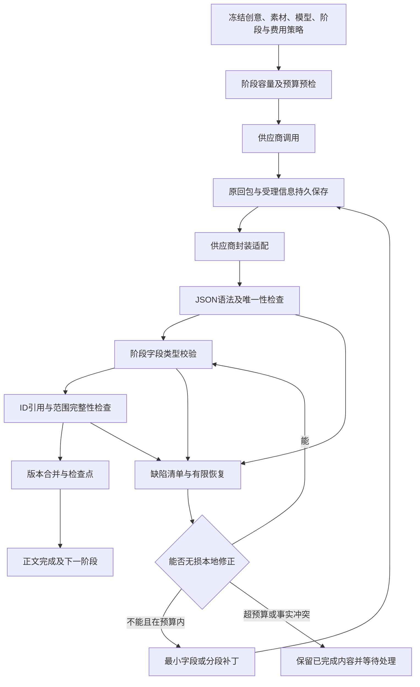

# 短剧剧本生产可靠性专项优化方案

日期：2026-10-29。状态：**待实施方案**。依用户“先完善优化方案”的要求，本次只做源码只读审计和文档完善，没有修改生成器、解析器、测试、运行配置或数据库，没有发起模型调用。此前已经完成的模型选择恢复和部分数组边界修复，见[总体方案](short-drama-canvas-flow-optimization-2026-10-29.md)，不作为本专项已经实现的内容。

源码基线：server `f401a7c4afeda8440d176186c10a7c48fa504858`，web `b635f877f5a04052b26d072d30a972ee0782f4dd`。新增截图提示“骨架缺少必要内容：subjects”。没有拿到该截图对应的原始回包和任务快照，不能认定某一种原因已被现场证实；以下分清源码已确认的缺口和待实测的风险。

## 1. 目标与不可破坏的约束

交付目标是：有效输入经受控生成后，得到可编辑、可引用、可继续制作的完整剧本；所有标记成功的结果必须满足统一契约。异常可以准确定位、有限修复、断点恢复，已有内容和账目有据可查。

必须同时满足：

1. JSON可解析、类型正确、ID与引用正确、范围完整，才允许进入下一阶段或标记完成。
2. 结构合法不等于剧情完整。另核对用户明确事件、关键台词、人物/场景、集号与收场状态；可选的文学质量复核不影响基础校验。
3. 上游原回包先持久保存。规范化结果、补丁、成功版本单独记录，不能覆盖已付费原文。
4. 已通过的集、场、镜头不随局部修复改写。用户主动调整剧情创建新版本并标记受影响内容。
5. 不用空角色、假地点、虚构台词或拼接括号补成“成功”；不能通过过滤坏项悄悄减少集数或镜头数。
6. 网络受理不明、余额/结算异常、安全拒绝不走普通格式重试；它们有独立恢复路线。
7. 新的收费修复受预算和承担策略约束；查询、解析已有回包、确定性格式适配不再调用模型。

供应商仍可能拒绝、截断或持续返回无效内容。验收要证明系统能正确产出或保留可恢复结果，不能用“任何供应商任何输入100%一次成功”替代工程标准。

## 2. 截图错误如何产生，应该如何处理

### 2.1 当前已确认的处理链

`ShortDramaScriptGeneration::assertSkeleton` 与 `ShortDramaTimedScriptGeneration::assertSkeleton` 都要求 `subjects` 非空，缺失或空数组均会抛出截图文案。它不是单纯的页面展示报错，表示结构未通过生产门槛。

`ShortDramaSkeletonFieldRepair::targets` 在 `title/story_outline/subjects/locations` 任一为空时直接返回空目标。现有局部修复主要针对 `scene_beats` 的字段，不能补齐缺失的顶层角色或场景。普通骨架最多尝试2轮，定时骨架最多3轮，顶层缺失会进入整份骨架再生成；再次缺失就终止。

这说明需要保留基础校验，同时扩大“准确补缺”的能力。取消 `subjects` 校验会让后续主体绑定、人物图和镜头引用继续出错。

### 2.2 必须区分的五种情况

| 原始回包/上下文 | 应采取的动作 | 禁止的动作 |
| --- | --- | --- |
| 返回 `characters/roles`，对象结构与已声明适配规则一致 | 在阶段校验前做无损字段映射，记录映射来源，再核验ID与字段 | 任意把同名字符串列表猜成人物对象；有冲突时任取一份 |
| 合法正文仍被 `data/result/plan/payload` 包裹 | 按该供应商明确的封装契约解包，再进入业务校验 | 从任意嵌套/多个候选中挑一个看起来最完整的对象 |
| 回包漏掉 `subjects`，但已确认故事或素材登记中有本阶段权威角色 | 复用权威角色定义及稳定ID；检查本阶段所有引用与已确认事实是否吻合，记录继承来源 | 从角色名字猜ID，覆盖已有角色身份，把全库无关人物塞进当前集 |
| 回包确实漏掉必要角色，且无完整权威来源 | 保存已有场次，仅请求缺失的角色字段补丁；补完后全量交叉校验 | 让模型重写全部剧情，或者生成“默认主角”占位 |
| 用户明确要求纯风景/无出场主体 | 以该任务冻结的条件契约允许空主体；镜头主体引用也必须为空，声音规则另核对 | 对有人物/人物对白的剧本普遍允许空数组，或为了通过校验硬造人物 |

是否属于上述哪一类，需要原回包和冻结输入判断。截图库错误本身不能证明是别名还是漏字段。

## 3. 源码审计：具体缺口与影响

本表是静态代码证据。除总体方案上一轮明确列出的已通过测试，本专项没有运行新的故障复现或模型实测。

| 编号 | 已确认源码行为 | 风险或用户后果 | 改造方向 |
| --- | --- | --- | --- |
| R01 | 共享解析器与 `InputContract::formatRepair` 多处把 `content` 强转字符串 | 数组/对象可能触发PHP异常，修复提示本身也可能再次失败 | 供应商适配层规范化文本，原响应保持类型；解析器做显式类型检查，统一结构错误 |
| R02 | 共享 `decode` 从第一个 `{` 开始，找到闭合对象即返回 | 根列表可能被偷取第一项；多份业务JSON可能只采用第一份，后续内容丢失 | 扫描完整响应、区分object/list、检测二义性和残缺尾部 |
| R03 | 解码为关联数组后，安全wrapper可把列表解出来；重复键被JSON解码覆盖 | 字段被覆盖或错误容器进入业务层，报错位置靠后 | 解析时保留JSON类型信息；重复关键键检测，明确返回契约错误 |
| R04 | 新共享解析仅认特定wrapper；旧主服务还有评分选对象、更多封装与别名逻辑 | 同样的模型回包在不同入口表现不一致 | 统一新任务的适配与校验；旧任务通过版本适配保留已提交语义 |
| R05 | 局部骨架修复要求顶层核心字段已非空 | 缺一个角色/地点列表也只能整份再生成，容易改写已有剧情 | 增加顶层字段补缺，权威素材继承优先，补丁只准改白名单 |
| R06 | 部分骨架/整份剧本校验先用 `empty()`，随后直接 `array_column/array_diff`、数组索引或字符串转换 | 非空字符串、嵌套引用、错误ID类型可绕过浅校验，再出现TypeError/告警 | 所有集合、元素、ID、引用、数字先类型校验，再业务运算 |
| R07 | `canonicalSkeleton` 会转字符串ID；`normalizeSceneScripts` 有字符串转换和过滤 | 结构值可能异常；不合格动作/对白有被过滤、用回退内容替换的风险 | 只做白名单无损适配；明确记录缺陷，不静默丢掉用户/模型返回的剧情 |
| R08 | 非定时完整计划的基础 `assertPlan` 主要检查非空；定时路径又有另一套完整校验 | 不同路径对名称、描述、镜头正文和对白要求不一致 | 一个版本化阶段契约覆盖快速完整输出、分段输出及合并结果 |
| R09 | 一次回包包含部分合格内容时，修复常受原整批/整份边界约束 | 有效场次或集数反复重算，时间、费用和内容漂移增加 | 按字段/镜头/场/集记录验证结果，只补缺失或坏项 |
| R10 | “JSON完成、基础结构有效、正文范围完整、质量复核通过”缺少一致的前台解释 | 出现已显示正文却仍失败、或只看到英文缺字段错误 | 分开草稿预览/正文完成/待复核/待修复/待核对；主提示用可理解中文 |

特别注意：旧 `decodeLlmJsonObject` 的测试明确允许“围栏计划 + 第二份diagnostic JSON”，也允许 `code/data/content` 供应商封装。不能通过全局切换解析器直接破坏这类历史任务，也不能因此允许新入口任取第一份JSON。必须先列出入口、版本、适配profile与测试样本。

主要源码定位（以上述基线为准）：

- `ShortDramaScriptGeneration.php:137–180、280–346`：普通骨架2轮、顶层必填项和分镜校验。
- `ShortDramaTimedScriptGeneration.php:36–113、518–576、574–651、818–839`：定时骨架3轮、素材ID规范化、动作/对白规范化、骨架/分镜校验。
- `ShortDramaSkeletonFieldRepair.php:10–16、45–92`：顶层缺失时退出、限定scene补丁及最多2轮。
- `ShortDramaStructuredResponse.php:13、49、137–185`：content转换、结束原因和对象解析。
- `ShortDramaInputContract.php:99–104`：格式修复原响应处理；`ShortDramaPlanningUnit.php:225–242、274–278`：校验缺陷标记与received重放。
- `AigcShortDramaService.php:17697–17729、20169–20400`：新生成器调用、旧解码/封装与别名恢复；`tests/Feature/ShortDramaTextModelContractTest.php:10–40`：旧入口兼容样本。

## 4. 统一处理链

图中的“检查失败”分流只适用于可恢复的结构/业务缺陷。安全拒绝、提交受理不明、价格和结算问题直接进入各自状态，不进入自动格式补丁环。

## 5. 每个阶段的输出契约

契约由服务端根据已冻结的阶段选择。模型只返回该阶段内容，不决定tenant/user、价格、任务状态或接下来是否收费。提示词中的字段说明、请求的结构化输出schema和后端校验来自同一份版本化定义，避免三份规则不同步。

| 阶段 | 必需内容 | 成功门槛 | 不应要求重复返回的内容 |
| --- | --- | --- | --- |
| 故事设定 | title、type_judgement、core_theme、story_outline、subjects、locations；启用对应规则时的series_bible | 文本类型正确；角色/场景对象有稳定唯一ID和必要描述；用户明确事实保留 | 未确认的分集正文、制作分镜、媒体提示词 |
| 全剧节奏 | segments，每段start/end/goal/reveal/ending | 完整连续覆盖总集数，无重叠、越界或提前终结；不改已确认设定 | 每集完整正文、全部素材定义 |
| 分集大纲 | episodes，每项episode_number/title/story_outline/conflict_point/ending_hook | 集号唯一；请求范围完整；批内/全局编号仅做明确一次映射；缺集不能标完成 | 全局角色与场景全表、其他批次正文 |
| 单集分场骨架 | title、story_outline、subjects、locations、scene_beats，以及按版本要求的script_lines/scene_script | 顶层字段类型、角色/场景引用、场次顺序、动作对白结构均有效；定时任务额外验证预算 | 完整图片/视频提示词、负面提示词、音乐方案 |
| 局部分镜 | 当前required_shot_ids对应storyboard；镜头ID/场景/主体引用/visual_description/dialogue/voice_role/speech_type/时长 | 数量与ID集合精确匹配，无错场、重复或非法主体；字段类型正确；范围与时长守约 | 已冻结角色/地点全表、其他场次分镜 |
| 字段补丁 | 服务端指定target对应fields或patches | 目标和字段集合与允许范围完全一致；应用补丁后重新检查整体不变量 | 未失败镜头、其他集、其他人物与剧情 |
| 剧本合并 | 引用已通过的设定、大纲、场次、分镜与版本 | 集/场/镜头清单齐全；用户明确内容覆盖；无悬空引用；合格内容版本一致 | 再请求模型重写一份完整剧本 |
| 可选质量复核 | 结构化问题、证据、允许的修复建议 | 对应正文hash和规则版本；正文完成状态独立保存 | 借质量复核改掉用户明确事实，或将格式问题伪装成文学问题 |

统一基础类型：

- 文本字段为字符串，必需正文非空；对象/数组不能通过强转变成文本。允许为空的对白、说话人按speech_type明确约定。
- 集合为list，元素为规定对象；不能用关联map、单对象、逗号分隔字符串代替，除非该profile有经测试的无损适配。
- ID为非空稳定字符串，项目内唯一。历史整数ID仅在明确、无冲突的兼容规则内规范化；禁止数组、对象、布尔ID和通过名称猜引用。
- 引用集合必须逐项为合法ID，先校验类型再求差集。主体、场景定义不能来自其他租户或不属于当前项目的素材。
- 时长是有限正数；用户明确时间码与所选视频能力一致时按其约束，冲突明确暂停，不缩台词/删剧情来凑时长。
- 只对影响当前阶段的字段设强制规则，媒体提示词等可派生字段在后续阶段生成，减少不必要输出负担。

## 6. 返回格式兼容白名单

| 返回形式 | 策略 |
| --- | --- |
| 单个完整JSON object | 接受解析，然后校验本阶段契约 |
| 空白、BOM、单个明确JSON代码围栏 | 去除外围格式标记；不修改JSON内部的台词、标点和正文 |
| 唯一业务JSON前后的普通说明 | 兼容profile明确允许时接受；必须确认无第二业务候选和歧义尾部 |
| 明确单键data/result/plan/payload包裹object | 有界解包；设置深度、字节和递归上限，防止无限嵌套 |
| characters/roles等别名 | 仅当前阶段与profile声明的同构映射可用；两个别名冲突时报错 |
| provider返回原生结构对象或content blocks | 先由该协议适配器按明确约定提取；保留raw，禁止在业务解析器里直接(string)转换 |
| 根列表、wrapper值为列表/字符串、多个业务JSON | 不任取第一项；生成明确契约缺陷，进入有界修复 |
| 重复关键字段或正文JSON后残缺结构 | 不静默覆盖/截取；保留原文，要求明确修复 |
| 非字符串传入只接受文本的共享解析接口 | 类型错误明确返回；修复提示保存原值及类型，不再次强转 |
| 安全拒绝content_filter/refusal/safety | 保留拒绝状态，不做内容恢复或自动绕过 |
| 输出截断length/max_tokens/max_output_tokens | 保存完整字段和完整镜头作为恢复输入；未闭合项不接受为完成；后续缩小单元补齐 |
| 字符串中的括号、引号、围栏和JSON示例 | 按JSON词法识别字符串边界，不能用简单正则从正文中抓对象 |

不在白名单中的新格式先进入诊断样本库，明确其协议含义后再做版本化适配。不能为提高通过率无限扩展猜测规则。支持严格结构化输出的渠道可使用能力开关，仍需后端校验；不支持的渠道不能硬传该参数。

## 7. 最小修复与恢复策略

按以下顺序执行，每一步都重新检查契约：

1. **读原回执**：已有received不再提交相同模型请求；区分未解析、已解析无效、已通过和待核对。
2. **本地无损适配**：外围标记、明确封装、明确别名、稳定ID的安全兼容；记录变换来源和原hash，不收费。
3. **继承权威字段**：从已确认故事、同集素材登记或已冻结阶段恢复缺失角色/场景；核对范围与引用，保留来源版本。
4. **字段补缺**：向模型提交失败字段路径、完整原值、合法引用集合和必要上下文，仅允许这些字段变化。顶层字段与scene/shot字段都有对应补丁契约。
5. **缩小范围**：坏格式或截断发生在多集/多场/多镜头时，保留已通过项目，只生成缺失项；不能因为缩批改变全局编号或场次事实。
6. **到限暂停**：所有补丁受同一任务剩余预算和次数约束，不允许“整份重试 → 局部修复 → 缩批重试”分别重置预算形成无界循环。
7. **恢复原位置**：用户继续时先重新验证已保存的原回包与补丁，从缺失单元开始。输入变化时创建新版本，已提交模型、价格和回执不重写。

建议初始护栏（均为方案参数，实施时再通过样本校准）：每个缺陷目标最多2次新增格式修复；连续两次返回相同缺陷指纹则停止同策略循环。策略切换也扣同一全局预算；次数上限不能代替金额/token上限。纯本地适配和回执重放不消耗模型调用次数。

缺陷结构至少包含：阶段、JSON路径、错误码、期望类型、实际类型、受影响ID、是否可本地恢复、原回执引用、缺陷指纹。普通用户看到中文原因和恢复动作，后台可展开技术路径，不显示上游密钥或原始内部提示词。

例如 `subjects` 缺失时，前台提示：“人物资料未完整生成，已有场景已保存，正在补齐人物资料。” 到预算或次数边界后说明缺什么、已完成多少、继续是否产生费用，而不是直接显示“骨架缺少必要内容：subjects”。

## 8. 完整性核对不能只看JSON

创建任务时冻结生产清单：目标集号、用户明确场次/事件/台词、素材ID、时长与版本。生成过程中另记完成清单，不让模型自己宣布“全部完成”。

- 多集：1至N或用户指定范围无缺集、重复、越界；未完成某集时保留其他集的正文。后集能否继续取决于所需的已确认连续性事实，不由固定批次边界决定。
- 每集：已确认场次/剧情单元都有对应分镜，顺序和入场/退场状态可追踪；合并来自当前版本的已通过单元。
- 镜头：请求ID集合与结果ID集合一致；数组长度相同还要逐项核对ID、所属场景和正文。
- 台词和事实：用户明确原文不能在格式规范化时删除或“压缩”。建立原文片段与生成结果的来源关联；语义覆盖采用可选复核或人工确认，不能仅靠字面匹配宣称正确。
- 引用：所有出场主体、地点、说话人、素材绑定在允许范围；空镜头明确允许空主体引用，不能触发伪造角色。
- 完成状态：预览内容、检查点、基础结构通过、正文完整、可选复核结果分别记录。媒体生产只能使用达到对应门槛的当前版本内容。

## 9. 内部步骤、用户确认和费用

内部自动执行：协议适配、格式校验、合法继承、局部补丁、回执查询、检查点、预算内分段推进。用户不必理解骨架或逐次点击JSON修复。

保留用户决策：故事/大纲关键事实确认、明确事实冲突、改变收费模型或规格、扩大预算、提交结果无法判定而可能二次收费、用户主动新创作。

承担策略延续总体方案：创作文本与Agent文本由租户后台独立配置；格式修复、路由与提示词整理等内部辅助建议租户承担，仍记录真实成本。若配置为用户承担，修复须处在事先告知的预算内，超限暂停。已有付费调用不能因为父任务失败自动宣称免费；本地格式适配、原回执重放和素材引用不新扣费。

项目费用显示故事、大纲、剧本、修复、复核、Agent和媒体分项；每一项关联实际消费记录、预占/已扣/退款/待核对状态。预算预估与最终usage分开，不能承诺一个没有最大输出边界的固定总价。

## 10. 工程落地步骤及交付物

| 顺序 | 工程内容 | 明确交付物 | 完成门槛 |
| --- | --- | --- | --- |
| 1 | 盘点现有入口、任务版本、供应商适配与原始坏回包 | 入口/版本/profile矩阵，脱敏样本库，字段职责表 | 每种错误可定位到具体阶段；不靠截图猜唯一根因 |
| 2 | 建立统一阶段契约与缺陷报告 | 版本化schema/验证器、提示词结构生成、错误码目录 | 故事/节奏/大纲/骨架/分镜/补丁/合并均覆盖；新旧路径差异有说明 |
| 3 | 收口协议适配与解析边界 | 原回包保留、白名单adapter、完整JSON词法及唯一性检查 | 类型错误无PHP warning；数组、双JSON、截断和拒绝分流正确 |
| 4 | 改造骨架顶层补缺和类型门槛 | 权威素材继承、顶层字段补丁、统一ID/引用校验 | `subjects`缺失可按原因局部恢复；已有场次不改写；无权威来源不造数据 |
| 5 | 接入受控续写与完整性清单 | 集/场/镜头完成记录、缺陷指纹、预算/次数门禁、断点恢复 | 缺一项只补一项；重复继续不重扣；到限可解释地暂停 |
| 6 | 补齐用户状态与费用可见性 | 中文阶段状态、可用内容预览、修复说明与分项账单 | 用户知道完成什么、缺什么、是否收费，不面对内部骨架技术错误 |
| 7 | 回归、灰度与发布验收 | 离线矩阵报告、真实模型报告、账本对账、worker版本核验、回滚说明 | 所有强制门槛通过后才扩大范围；未通过保留旧路径与数据 |

建议的代码职责划分（名称仅为方案）：

- 保留共享市场运行时负责供应商调用和消费，不将其改造成剧本业务解析器。
- 共享响应适配/解析负责格式；阶段契约服务负责结构、ID、范围；故事/剧本生成器负责顺序和检查点。
- 角色/场景登记和字段继承负责权威数据；全局字段补丁与现有scene/shot补丁共用白名单/版本核验基础。
- `PlanningUnit`继续负责提交幂等、原回执和恢复身份；新增校验结果与缺陷关联，避免到处根据中文错误字符串分支。
- 费用策略/预算放共享服务，正文生成器引用冻结结果；禁止每个修复分支自行扣余额或重置预算。

实施前先审核持久化字段能否复用现有JSON/任务表；如需新增字段，再同时设计安装、升级、已有租户兼容、回滚，方案阶段不预先执行SQL。

## 11. 版本兼容与上线方式

1. 新契约只用于新建任务或用户明确创建的新版本，保存schema/profile/model/prompt/billing版本。
2. 运行中、已收到回包的历史任务保留原模型、请求签名和计费语义；可复用新的无损解析器读取原文，但不能改签名重新提交。
3. 历史格式的适配规则与新任务规则分别有测试。兼容失败明确保留原内容，不将旧回包写坏。
4. 功能开关按租户/应用/任务版本灰度；关闭开关停止新任务进入新路径，已生成内容和账单继续可查。
5. 发布时核对完整规划、剧集和画布worker组、任务积压、加载版本；先排空安全单元再重载，不能杀掉受理不明的付费请求。
6. 监测格式失败、字段缺失、局部修复命中率、最终完整率、相同缺陷重复、任务停留时间与每完成一集费用；不把“HTTP 200/JSON可解析”当生产成功率。

## 12. 必须执行的验收矩阵

本表是待执行验收，不代表已经通过。建议先建不少于50种脱敏离线回包样本，再按预算选择实际在售官方/三方渠道做真实生产验证；没有对应渠道时明确记录缺项，不伪造覆盖。

| 类别 | 样本/故障 | 预期结果 |
| --- | --- | --- |
| JSON基础 | 标准object、中文、转义引号、字符串内括号/围栏 | 正文原意与值保留；解析准确 |
| 外围格式 | 空白、BOM、围栏及BOM+围栏、单对象说明 | 白名单适配一致；完整字段不丢 |
| 封装 | 已声明wrapper、深层wrapper、同级业务字段、未知wrapper | 按profile安全解包；有界；不丢同级字段 |
| 二义性 | 根列表、双业务JSON、重复关键键、对象后残缺JSON | 明确缺陷，不能取第一项/最后值假成功 |
| 类型 | content数组/对象/null；title数组；subjects字符串；嵌套ID/ref | 无PHP告警/TypeError；指向具体阶段和路径，原值保留 |
| 角色缺失 | 漏subjects、characters别名、空列表、权威设定存在/不存在 | 分别适配/继承/局部补齐；不整份改写、不虚构角色 |
| 无人镜头 | 确认纯风景、人物剧本中的空镜、有人物对白但主体空 | 条件契约允许合法空主体；矛盾数据明确失败 |
| 引用 | 重复ID、同名不同人、错场、跨项目素材、未知说话人 | 不名称猜测；引用一致；权限边界保留 |
| 分场/对白 | 动作别名、对白对象/字符串、字段嵌套、长台词 | 仅无损白名单适配；坏项有缺陷记录，台词不静默丢失 |
| 范围 | 少集、多集、重复集、批内/全局编号；少镜头/错镜头ID | 全局范围精确核对；只补缺失和坏项 |
| 截断 | 第11集或分场中断、完整前缀+半个镜头、嵌套引号未闭合 | 已通过前10集/完整镜头保留；残缺项不作为完成 |
| 补丁 | 越权改字段、改已通过场次、目标漏项/重复、旧版本补丁 | 拒绝应用；原正文和原回执不变 |
| 预算 | 连续相同缺陷、两轮无效修复、缩批后继续超额 | 同一总预算生效；到限暂停，不形成新的无限循环 |
| 幂等 | 双击、刷新、重新登录、两worker、重复回调 | 已受理/received回执复用，不重复生成或扣款 |
| 运行异常 | 连接建立前失败、读超时、worker退出、安全拒绝 | 明确分流；未知受理先核对，拒绝不走格式绕过 |
| 结算 | 余额不足、租户承担/用户承担、延迟usage、结算失败 | 真实消费可追踪；不中途换承担策略；费用状态准确 |
| 完整流程 | 单集；3/10集；通过后逐步扩大到20集 | 从创意到完整可编辑剧本可恢复推进；集/场/镜头/事实清单核验；原始回执与账单对应 |

强制发布门槛：所有非法结构样本均被准确阻断或安全恢复；任何success结果均通过阶段与最终完整性门槛；已通过正文和付费原回执在失败/恢复后不变；固定输入下无未捕获的数组转换/类型异常；重复操作不新增重复消费。真实生产成功率、耗时和费用范围从实际样本报告，不预先编造。

## 13. 评审时需要确定的产品规则

建议先按以下默认方向评审，不阻塞方案编写：

- 无出场主体作品采用内部条件契约，不新增一堆用户必须填写的表单；有人物时仍强制完整登记。
- 用户确认故事和大纲后可选择连续生成；仅用户设置的审查点、事实冲突、预算变化和不确定付费重试打断。
- 内部格式修复建议租户承担并设成本上限；用户主动重新创作按创作文本策略结算。
- 基础结构和完整性检查始终生效；文学质量复核可选，结果与正文分开。
- 首先完成文本剧本可靠性、恢复与费用边界，再扩大自动图片/视频生产，避免前置正文不完整时继续发生媒体费用。
